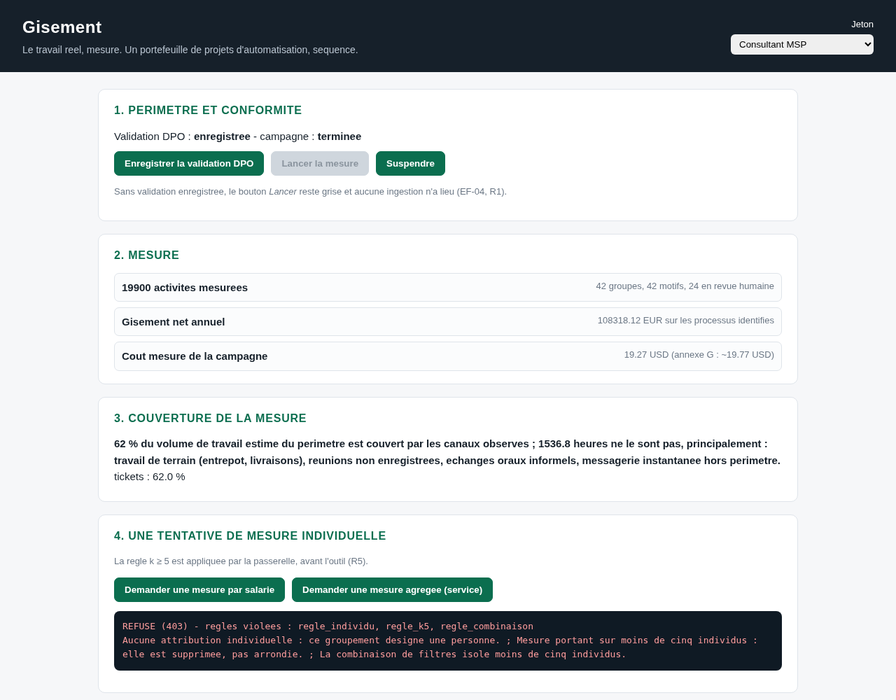

# Gisement

**Map the real manual work of a client, measure it, and deliver a sequenced
portfolio of automation projects — sold as a recurring service by an MSP.**

AWS MSP AI Hackathon · Track 2 — Deliver AI-Driven Outcomes for Customers.

> A client says "we would like to automate". Nobody knows what. The MSP bills a
> scoping study, produces a slide deck, and **80 % of it never happens**.
> Gisement does not read the procedure manual: it reads the work — the tickets,
> the emails, the documents, the recorded calls, the application logs — and
> answers with numbers, intervals and a sequence.



*The portal, on the public demo: an individual measure is refused by the gateway
with the three rules it breaks - before any tool runs. The animated version is
`media/demo-refus-k5.gif`, and the live site is
[baptistefaisy.github.io/gisement](https://baptistefaisy.github.io/gisement/).*

## Why it is different

1. **It measures the real work, not the declared work.** The written procedure
   says the order is keyed into the ERP. In practice it arrives by email, is
   copied into a local spreadsheet, re-keyed by someone else, then checked by
   phone. Automating the declared process automates something nobody does.
2. **It computes the net gain, not the gross one.** A 48 h/month process does
   not give back 48 hours. On the reference case the naive calculation promises
   a payback in 5.2 months; the real one is **13.7 months** — a factor of
   **2.61**. Every process report prints both columns.
3. **It sequences, it does not rank.** The biggest deposit is usually the
   riskiest and the longest. The deliverable is a wave 1 that is fast, visible
   and safe, then the rest.
4. **It says no.** Processes that must not be automated are published with the
   reason and the re-examination condition — 15 to 30 % of a healthy portfolio.
5. **Individual attribution is impossible by construction.** Every published
   measure covers at least five individuals, pseudonymisation happens at
   ingestion before any model sees anything, and the rules are enforced by the
   gateway (AgentCore Policy), never by a sentence in a prompt.

## AWS services

| Service | Role |
|---|---|
| Amazon Transcribe | Calls and meetings → text, diarised, with native PII redaction |
| Bedrock Data Automation | Structured extraction from documents and forms |
| Amazon Comprehend | Entities, language and PII detection at ingestion (sensitive category filter) |
| Amazon Bedrock | Classification of activities into motifs, drafting of business cases |
| Bedrock Knowledge Bases | The motif catalogue and the client procedures |
| AgentCore (Runtime, Gateway, Identity, Policy, Memory, Observability) | Isolated analysis sessions, tenant from the token, **k ≥ 5 enforced at the gateway**, longitudinal follow-up, measured cost |
| Strands Agents | The collectors: one bounded agent per channel |
| Amazon Quick | Portfolio, waves, trends, anonymised cross-client comparison |
| Lambda, Step Functions, DynamoDB, S3, Cognito, API Gateway, CloudFront | Orchestration and storage |

## Layout

```
src/gisement/     the product: types, calcul, motifs, canaux, assainissement,
                  classifieur, processus, politique, faisabilite, sequenceur,
                  deconseil, rapports, suivi, api, stockage, observabilite
catalogue/        the 40 automation motifs, as data (adding one needs no code)
config/           prices, campaign caps, priority weights (versioned)
demo/             the synthetic client: generator + frozen corpus + ground truth
eval/             the evaluation harness (classification, k >= 5, economics)
portal/           the static portal served by the API
iac/              CDK deployment
docs/             CONTRACTS, HLD, ARCHITECTURE, RUNBOOK, SUBMISSION, SPEC.fr
```

## Two corpora: the synthetic demo, and a real client

The demo corpus is synthetic and frozen. The second corpus is **real**: the
Apache Kafka project of the ASF, read over HTTPS by real connectors - the ASF's
own Jira, the real GitHub tracker of the project, the public mailing-list
archives, the public Confluence where the design documents live.

| | Demo | Corpus réel |
|---|---|---|
| Records | 19 900 (synthetic) | 3 707 (real, public, pseudonymised) |
| Window | 6 months | 6 real months (2025-05 → 2025-10) |
| Perimeter | 23 processes (ground truth) | 12 processes (real components, real model) |
| Motifs | 40 back-office | 40 back-office + 12 added by the measure on the real corpus |
| Durations | measured (templated) | **inferred** from the catalogue: no tool time-stamps the work |

The portal has a **Corpus** switch: the same handlers produce both cards, so the
site cannot show a figure the API would not produce. `docs/REEL.md` has the
sources, the licences, the privacy measurements, and the **nine things the
real corpus taught the product** (including one real aggregation bug it
exposed).

## Run it

```bash
python3 -m pip install --user -e ".[dev]"
make all        # ruff + size guard + offline tests
make smoke      # the whole pipeline on the frozen demo corpus
make demo       # regenerate the synthetic client, then smoke
make eval       # the evaluation harness
```

Everything runs **offline**: no AWS credential is needed, and no test ever calls
Amazon Transcribe or Bedrock Data Automation (they are 94 % of the cost of one
mapping — spec §26.4). The real adapters exist behind a protocol and are
exercised with fakes.

## Documents

| Document | What it is |
|---|---|
| `docs/HLD.md` | High level design |
| `docs/ARCHITECTURE.md` | Architecture diagram (Mermaid + SVG) |
| `docs/CONTRACTS.md` | The frozen contracts between the lots |
| `docs/TRACEABILITY.md` | Requirement → lot → test |
| `docs/TEST-INSTRUCTIONS.md` | How a judge reproduces the demo |
| `docs/RUNBOOK.md` | Deploy and operate |
| `docs/REEL.md` | The real corpus: sources, licences, privacy, and what it measured |
| `docs/SUBMISSION.md` | Devpost description |
| `docs/fr/CAHIER-DES-CHARGES.md` | The full French specification this code implements |

## Rules of the codebase

Files < 500 lines, functions < 50 lines, CI verdict in 5 minutes, Mergify is the
only merge pilot. Amounts are `Decimal`, computed by code — **a model never
computes a figure**.

## Licence

MIT. The demo dataset is entirely synthetic and watermarked
`SYNTHETIQUE — DEMONSTRATION`; it contains no real personal data. The real
corpus holds **public** data of the Apache Software Foundation (Apache License
2.0), pseudonymised at ingestion: no name, no address and no account of a real
person is committed, and the raw downloads are never committed either.
