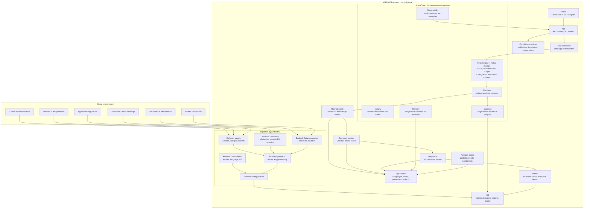

# Architecture — Gisement

Track 2, AWS MSP AI Hackathon. Region `eu-west-3` (Paris), fallback
`eu-central-1`. Serverless only: no dedicated endpoint, no always-on
SageMaker, no GPU (26.4).

## Overview

## Role of each service

| Service | Role | Essential or infrastructure |
|---|---|---|
| **Amazon Transcribe** | Calls and meetings → text, diarised, with native PII redaction | Essential: the only way to make the most invisible channel measurable |
| **Bedrock Data Automation** | Structured extraction of documents and forms | Essential: hand-kept documents are the main deposit of an SMB |
| **Amazon Comprehend** | Entity, language and PII detection at ingestion | Essential: it applies the sensitive-category filter |
| **Bedrock** (models) | Classification of activities into motifs, drafting of business cases | Essential |
| **Bedrock Knowledge Bases** | The motif catalogue and the client procedures | Essential |
| **AgentCore Policy** | k ≥ 5, non-attribution, budget, suspension - imposed before the tool | **Essential: the architectural differentiator** |
| **AgentCore Identity** | Tenant derived from the token, never from text | Essential |
| **AgentCore Runtime** | Analysis sessions isolated per campaign | Essential |
| **AgentCore Gateway** | Single tooled access to the sanitised corpora | Essential |
| **AgentCore Memory** | Longitudinal follow-up of realised against predicted, across quarters | Essential: this is what makes the service recurring |
| **AgentCore Observability** | Cost measured per campaign, traceability of classifications | Essential (KPI-8) |
| **Strands Agents** | The collectors: multi-channel, tools, structured output, pausable | Essential |
| **Amazon Quick** | Portfolio, sequence, trends, anonymised cross-client comparison | Essential |
| Lambda, Step Functions, DynamoDB, S3, Cognito, API Gateway, CloudFront | Orchestration and storage | Infrastructure |

The stack covers the three layers the rules reward: infrastructure (Runtime,
Gateway, Identity, Policy), tools for models and agents (Bedrock, BDA,
Transcribe, Comprehend, Knowledge Bases, Strands), and applications (Quick,
portal).

## The central architectural principle

**Pseudonymisation and the minimal aggregation are applied by the gateway,
before the tool, and never by the prompt.** A collector agent that tried to
produce an individual measure receives a Policy refusal naming the rule, and
the refusal is logged. It is demonstrable in thirty seconds (video 1:20).

This is the labour-law transposition of the security principle already applied
in `echeance`, `piege` and `sas`: the rules are enforced by the gateway, not by
a sentence in a prompt.

**Confirmed against the AWS documentation (decision D-22).** AgentCore Gateway
has two enforcement points, and Gisement uses both:

1. `AWS::BedrockAgentCore::PolicyEngine` + `Policy`, whose definition is a
   **Cedar** statement. `gisement.politique.cedar.politique_cedar()` generates
   14 `forbid` statements (one per rule of chapter 18, each commented with its
   rule id) and 5 `permit` statements (the five declared roles). Cedar is
   deny-by-default, which is exactly the fail-safe default the docs ask for.
2. A **REQUEST interceptor** Lambda (`gisement.lambdas.intercepteur`), which the
   gateway invokes *before* calling the target and which can short-circuit the
   call by returning `transformedGatewayResponse`. It enforces what Cedar cannot
   express (a person identifier hidden in a filter value, a rare
   quasi-identifier, the per-user request quota), reads the tenant from the
   bearer token, logs every decision, and refuses anything it cannot parse.

Both read the same registry (`politique/regles.py`), so the deployed policy and
the offline-tested one cannot drift.

## The flow in one sentence

Five channels enter, are pseudonymised and filtered **before** any model, then
classified into motifs, aggregated into processes, priced by deterministic
code, sequenced, and published as a portfolio.

## Offline by default

Every AWS service is reached through an adapter that has an in-memory fake, and
the demo corpus (frozen transcripts and extractions) is committed. The whole
pipeline - and the whole test suite - runs with no credential and no network,
and never calls Transcribe or Data Automation during development (26.4: they
are 94 % of the cost of a mapping).

## Deployment

See `docs/RUNBOOK.md` and `iac/` (CDK). The portal is static (S3 +
CloudFront + Cognito); the API is Lambda behind API Gateway; the state is
DynamoDB; the corpora and reports are in S3 with a bounded retention and a
proven purge (ENF-06).
