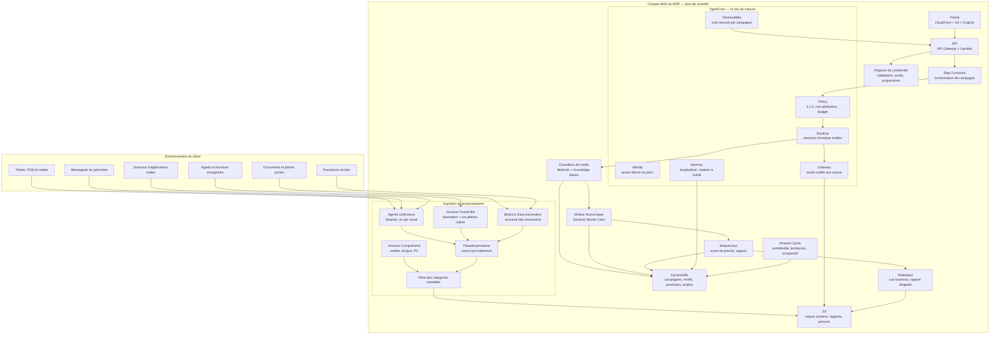

# Cahier des charges — Gisement

**Cartographie du travail manuel automatisable chez le client, mesurée sur le travail réel,
vendue en service récurrent par un MSP**
Version 1.0 du 11 novembre 2026 — Hackathon AWS MSP AI, Track 2

> Ce document est en français pour le travail interne. Tous les livrables de la soumission
> (description, vidéo, schéma d'architecture, document de conception, README) doivent être en anglais.
>
> Les faits marqués **(vérifié)** ont été lus dans la documentation d'AWS le 11 novembre 2026
> (sources en annexe H). Ceux marqués **(résultat de recherche)** n'ont été vus que dans un résumé,
> sans lecture de la page : ils sont à confirmer. Les chiffres marqués **(calculé)** ont été calculés
> pour ce document ; la méthode est en annexe G. Tout ce qui reste à confirmer est regroupé au
> chapitre 34.
>
> Les chapitres 18 et 24 touchent au droit du travail, à la représentation du personnel et aux données
> personnelles. Ce n'est pas un avis juridique : ils doivent être validés par un juriste avant toute
> mise en service réelle.

---

## 1. Fiche d'identité

| Élément | Valeur |
|---|---|
| Nom de travail | **Gisement** (alternatives : Filon, Cadastre — à changer librement) |
| Track | **2 — Deliver AI-Driven Outcomes for Customers** |
| Idée en une phrase | Un MSP observe le travail réel d'un client, mesure ce qui est manuel et répétitif, et livre un portefeuille de projets d'automatisation chiffrés, séquencés et honnêtes |
| Prix spécial visé | Aucun slot libre (les dix sont réclamés dans le portefeuille) — vise un **classement de track**. Candidat de repli : Best Amazon Quick Application T2 si `comptoir` n'aboutit pas, ou Best AgentCore T2 si `sas` n'aboutit pas |
| Services IA AWS | **Amazon Transcribe** (appels et réunions), **Bedrock Data Automation** (documents), **Amazon Bedrock** (classification, cas business), **AgentCore** (Runtime, Gateway, Identity, Policy, Memory, Observability), **Amazon Comprehend** (entités, langue, PII), **Amazon Quick** (portefeuille), **Bedrock Knowledge Bases** (catalogue de motifs) |
| Utilisateurs | Dirigeant et CFO du client, responsables de service, DPO et représentants du personnel, responsable de compte MSP, consultant avant-vente MSP |
| Modèle économique | Forfait de cartographie + abonnement trimestriel de suivi + **commission sur les projets d'automatisation vendus derrière** |
| Région proposée | **Europe (Paris) `eu-west-3`**, repli `eu-central-1` — disponibilité de Transcribe et de Data Automation à confirmer en S0 |
| Échéance de soumission | Vendredi 11 décembre 2026, 12h00 PT (21h00 à Paris) |
| Fin du jugement | 22 janvier 2027 : la solution doit rester en ligne jusque-là |
| Budget crédits | 200 $ par AWS Account ID, expirent le 31 décembre 2026 |
| Dépôt | `BaptisteFaisy/gisement` (privé, partagé avec les deux adresses du règlement) |
| Règles de code | Fichiers < 500 lignes, fonctions < 50 lignes, CI ≤ 5 min, Mergify seul pilote du merge |

---

## 2. Résumé

Un client dit : « on voudrait automatiser ». Personne ne sait quoi. Le MSP facture un cadrage,
produit un PowerPoint, et **80 % ne se fait jamais**.

Trois raisons expliquent cet échec, et ce sont les trois raisons d'être de Gisement.

**Premièrement, on cartographie le processus déclaré, pas le processus réel.** La procédure écrite
dit que la commande est saisie dans l'ERP. En pratique, elle arrive par courriel, est recopiée dans un
tableur par une personne, ressaisie dans l'ERP par une autre, puis vérifiée par téléphone. Automatiser
le processus déclaré revient à automatiser quelque chose que personne ne fait. Gisement ne lit pas le
manuel : **il lit le travail** — les tickets, les courriels, les documents, les appels.

**Deuxièmement, on calcule le gain en heures brutes, et ce chiffre est faux.** Un processus de
48 heures par mois ne rend pas 48 heures. Une partie est du travail fragmenté qui ne se récupère pas,
une partie est transférée vers la validation humaine de l'automatisation, une partie est inéliminable
parce qu'elle exige un jugement ou une signature. Sur l'exemple de référence de l'annexe A, le calcul
naïf annonce un retour sur investissement de 5,2 mois ; le calcul réel donne **13,7 mois**. L'écart est
un **facteur 2,61 (calculé)**. Un client qui signe sur 5,2 mois et découvre 13,7 mois ne rachète
jamais — et il le dit à ses pairs.

**Troisièmement, on classe par gain, pas par séquence.** Le plus gros gisement est souvent le plus
risqué et le plus long. Un client qui commence par celui-là échoue, et n'automatisera plus rien. Le
livrable de Gisement n'est pas une liste triée par euros : c'est une **séquence** — un premier projet
rapide, visible et sûr, puis les suivants.

S'y ajoute une contrainte que presque tous les outils ignorent et qui est ici **architecturale** :
Gisement observe le travail de salariés. Il ne peut donc **jamais** attribuer du travail à une personne
nommée. Toute mesure est agrégée au-dessus d'un seuil minimal de cinq individus, la pseudonymisation
est appliquée à l'ingestion avant que le modèle ne voie quoi que ce soit, et ces règles sont imposées
par AgentCore Policy au niveau de la passerelle — pas écrites dans une invite. Un outil qui classe les
employés ne passe ni le CSE, ni le DPO, ni le juge.

Enfin, un outil qui trouve toujours quelque chose à automatiser est un outil qu'on n'écoute plus.
Gisement publie explicitement les processus **qu'il recommande de ne pas automatiser**, avec le motif :
volume trop faible, jugement trop élevé, obligation légale de traitement humain, coût supérieur au
gain. Dire non est ce qui rend le oui crédible.

Le livrable est un **portefeuille de projets d'automatisation** : pour chacun, le volume mesuré, le
temps net récupérable avec son intervalle de confiance, le type d'automatisation recommandé, le coût,
le délai de retour, le risque, et sa place dans la séquence. Plus un suivi trimestriel du **réalisé
contre le prédit** — c'est ce suivi qui déclenche la deuxième vente.

---

## 3. Contexte et problème

### 3.1 Le marché

L'automatisation est la demande n°1 des PME et ETI, et le principal axe de croissance des MSP. Mais la
chaîne commerciale est cassée à son premier maillon :

| Étape | Ce qui se passe | Coût |
|---|---|---|
| Le client exprime un besoin vague | « On voudrait automatiser » | — |
| Le MSP facture un cadrage | 5 à 15 jours-hommes, ateliers, entretiens | 4 000 à 12 000 € |
| Le cadrage produit un rapport | 40 à 80 pages, lu par personne | — |
| Le client ne donne pas suite | **80 % des cas** | Perte sèche pour les deux |
| Les 20 % restants | Le projet démarre sur un cas mal choisi et dépasse le budget | Érosion de la confiance |

Le problème n'est pas l'absence d'opportunités d'automatisation. C'est l'absence d'un **instrument de
mesure crédible** pour les identifier, les chiffrer et les ordonner.

### 3.2 Pourquoi le cadrage classique échoue

1. **Il repose sur le déclaratif.** On demande aux gens ce qu'ils font. Ils décrivent la procédure,
   pas la pratique — par conformité, par oubli, ou parce que le contournement est devenu la norme.
2. **Il échantillonne mal.** Trois ateliers avec six personnes ne représentent pas 200 processus.
3. **Il ne mesure pas le volume.** « Ça prend du temps » n'est pas une mesure. Sans occurrences
   réelles, aucun chiffrage n'est défendable.
4. **Il ignore le travail invisible.** Le tableur local, l'appel non tracé, la vérification
   informelle : c'est souvent là qu'est le gisement, et aucun outil ne le capture.
5. **Il ne chiffre pas le coût de l'automatisation.** Un gain de 200 € par mois face à 15 000 € de
   développement n'est pas une opportunité.
6. **Il produit un rapport, pas un portefeuille.** Un document se range ; un portefeuille de projets
   avec cas business se vend.

### 3.3 Le cas qui motive le projet

Une PME de 120 personnes, distribution spécialisée. Le dirigeant veut « automatiser ». Le MSP facture
un cadrage de 8 jours. Le rapport identifie 14 opportunités, dont la première est l'automatisation du
service client par un agent conversationnel : gain annoncé 3 ETP.

Le projet démarre, coûte 68 000 €, et six mois plus tard le gain réel est de 0,4 ETP. Trois raisons :
le volume d'appels était saisonnier et avait été mesuré sur un mois de pointe ; une part importante du
travail était en fait de la saisie de commandes par courriel, pas des appels ; et la validation humaine
des réponses de l'agent avait été oubliée du calcul.

Le dirigeant n'a plus lancé aucun projet d'automatisation depuis. Le MSP a perdu le compte au
renouvellement suivant.

**Ce que Gisement aurait produit à la place** : une mesure sur 6 mois de données réelles, 23 processus
cartographiés avec leur volume, un premier projet à 6 900 € avec un retour en 4 mois sur la saisie des
commandes fournisseurs, et un avis explicite de **ne pas** automatiser le service client avant d'avoir
traité les trois processus amont qui génèrent 60 % des appels.

### 3.4 Pourquoi un MSP est le bon porteur

Le MSP a déjà trois choses qu'aucun éditeur d'outil n'a :

- **L'accès aux données réelles** : tickets, journaux, courriels, contrats — dans le cadre d'un
  contrat d'infogérance existant.
- **La relation de confiance** : le client accepte d'être observé par son MSP, pas par un inconnu.
- **La capacité d'exécuter ensuite** : identifier un gisement sans savoir le creuser ne vaut rien. Le
  MSP vend l'automatisation derrière, ce qui rend la cartographie presque gratuite à proposer.

C'est ce dernier point qui fait le modèle économique : **la cartographie se vend à prix coûtant, le
portefeuille de projets qu'elle produit est le vrai produit.**

---

## 4. Ce qui existe déjà et pourquoi ce n'est pas suffisant

| Approche | Ce qu'elle apporte | Ce qui manque |
|---|---|---|
| Process mining (Celonis, UiPath Process Mining) | Analyse des journaux d'événements d'un système, découverte de variantes | Exige des journaux structurés avec identifiants de cas — ce que la plupart des PME n'ont pas. Ne voit ni les courriels, ni les appels, ni le travail hors système. Licence coûteuse |
| Task mining | Capture d'écran et d'actions sur le poste de travail | Très intrusif, inacceptable pour un CSE, coût par poste élevé, couverture limitée aux postes équipés |
| Atelier de cadrage humain | Compréhension fine, adhésion | Déclaratif, échantillonnage faible, coût élevé, non répétable |
| Outil RPA avec son propre « discovery » | Catalogue de candidats à l'automatisation | Biaisé vers ce que l'outil sait faire : ne recommande jamais la suppression d'étape ni le changement de processus |
| Enquête interne et sondages | Ressenti des équipes | Déclaratif, non chiffré, non rejouable |
| `marge-msp` (même portefeuille) | Marge par client du MSP | Regarde le MSP, pas le client. Aucun recouvrement |
| `comptoir` (même portefeuille) | Analytics retail pour commerçants | Vise la donnée commerciale, pas le travail. Vertical différent |
| `problemes-caches` (actif adjacent) | Grappes d'incidents JSM et leur coût | Vise les incidents récurrents, pas les processus de travail. Méthode de grappes réutilisable, objet différent |

**La distinction décisive avec le process mining** : le process mining part des journaux d'un système
et remonte au processus. Gisement part de **tous les canaux du travail** — y compris ceux qui ne
produisent aucun journal structuré — et descend vers le processus. C'est ce qui le rend applicable à
une PME de 120 personnes sans data warehouse, donc au marché réel d'un MSP.

---

## 5. Objectifs et indicateurs

### 5.1 Objectifs

1. **O1** — Mesurer le travail manuel réel, pas le travail déclaré, avec une couverture explicitement
   publiée.
2. **O2** — Chiffrer le gain **net** récupérable, avec un intervalle de confiance, jamais un nombre
   unique.
3. **O3** — Produire un portefeuille **séquencé** : quoi faire en premier, et pourquoi.
4. **O4** — Dire explicitement ce qu'il ne faut pas automatiser.
5. **O5** — Garantir la non-attribution individuelle par construction, pas par promesse.
6. **O6** — Suivre le réalisé contre le prédit, pour rendre la deuxième vente possible.

### 5.2 Indicateurs

| Id | Indicateur | Définition | Cible de démo |
|---|---|---|---|
| **KPI-1** | Heures manuelles identifiées | Heures mensuelles de travail répétitif mesurées sur les canaux couverts | Mesuré sur le jeu de démo |
| **KPI-2** | € automatisables nets | Gain annuel net après fragmentation, transfert et inéliminable | Publié avec intervalle |
| **KPI-3** | Couverture de la mesure | % du volume de travail estimé couvert par les canaux observés | Publiée, jamais implicite |
| **KPI-4** | Écart au calcul naïf | Facteur entre le gain brut annoncé et le gain net réel | **2,61 sur le cas de référence (calculé)** |
| **KPI-5** | Délai de retour médian | Mois avant récupération du coût d'automatisation, par projet | Publié par projet |
| **KPI-6** | Précision de la prédiction | Réalisé contre prédit, mesuré au trimestre suivant | Écart < 25 % |
| **KPI-7** | Projets déclenchés | Nombre de projets d'automatisation vendus après la cartographie | Le vrai KPI commercial du MSP |
| **KPI-8** | Coût par cartographie | € réels consommés, mesurés | ≤ 20 $ en mode mixte **(calculé, annexe G)** |
| **KPI-9** | Processus déconseillés | Nombre de processus explicitement recommandés « ne pas automatiser » | ≥ 15 % du portefeuille |

KPI-1, 2, 4 et 9 apparaissent dans la vidéo. KPI-4 est le chiffre qui emporte l'adhésion d'un juge
métier : il prouve que l'outil ne gonfle pas ses promesses. KPI-9 est celui qui prouve qu'il n'est pas
un outil de vente déguisé.

---

## 6. Périmètre

### 6.1 Dans le périmètre

- Cinq canaux d'observation : tickets ITSM et métier, courriels (échantillon), documents, appels et
  réunions enregistrés, journaux d'application.
- Les processus de travail administratif et opérationnel tertiaire : saisie, rapprochement,
  vérification, relance, reporting, traitement de demande, classement, contrôle.
- Le périmètre d'un ou plusieurs services d'un client, déclaré à l'avance.
- La mesure sur une fenêtre glissante de 3 à 12 mois selon la disponibilité des données.
- Le portefeuille séquencé, le cas business par projet, le rapport dirigeant.
- Le suivi trimestriel du réalisé contre le prédit.

### 6.2 Hors périmètre

- L'implémentation des automatisations : c'est le projet vendu derrière, pas le produit.
- La surveillance individuelle des salariés : **interdite par conception** (chapitre 18).
- La mesure du temps de travail à des fins de paie ou de discipline.
- Le process mining au sens strict : Gisement n'exige pas de journaux d'événements structurés avec
  identifiants de cas.
- Les processus industriels automatisés (ligne de production, machine) : hors du terrain d'un MSP
  tertiaire.
- L'analyse de sentiment ou d'opinion des salariés.
- Toute donnée de santé, syndicale ou personnelle sensible au sens du RGPD : filtrée à l'ingestion.

### 6.3 Ce qui est délibérément limité

- **Échantillonnage des courriels** : on ne lit pas toute la messagerie. Un échantillon stratifié de
  1 500 à 3 000 messages, pseudonymisé à l'ingestion, suffit à estimer les volumes avec un intervalle
  publié. Lire davantage coûterait cher et serait disproportionné au sens du droit du travail.
- **Appels et réunions** : uniquement ceux déjà enregistrés avec consentement, ou enregistrés pour la
  mesure avec information préalable. Aucun enregistrement clandestin.
- **Catalogue de motifs** : 40 motifs d'automatisation au lancement (annexe B), pas 300.
- **Cinq canaux**, pas davantage : chaque canal ajouté augmente le coût et le risque juridique plus
  vite qu'il n'améliore la précision.

---

## 7. Utilisateurs et rôles

| Rôle | Qui | Ce qu'il fait dans Gisement | Droits |
|---|---|---|---|
| **Commanditaire** | Dirigeant ou DAF du client | Commande la cartographie, valide le périmètre, reçoit le portefeuille | Lecture de son tenant, validation |
| **Responsable de service** | Manager du périmètre observé | Complète la description des processus, valide les volumes, arbitre la séquence | Lecture et annotation de son périmètre |
| **DPO / représentant du personnel** | CSE, délégué syndical, DPO | Valide la conformité du dispositif, vérifie la non-attribution, peut suspendre | Lecture du registre de conformité, droit de suspension |
| **Consultant MSP** | Avant-vente ou delivery | Lance la mesure, examine les cas ambigus, rédige le portefeuille | Lecture du tenant, exécution |
| **Responsable de compte** | Commercial MSP | Voit le portefeuille, le pipeline généré, le coût | Lecture agrégée |
| **Agent collecteur** | Strands, autonome borné | Collecte et pseudonymise un canal | Aucun droit hors périmètre, imposé par Policy |
| **Agent classifieur** | Bedrock, sortie structurée | Classe les activités en motifs | Lecture seule, aucun outil |
| **Agent rédacteur** | Bedrock | Rédige le cas business et la synthèse | Lecture seule, aucun outil |

Le rôle **DPO / représentant du personnel** est un rôle de premier niveau avec un droit de suspension.
Ce n'est pas une concession cosmétique : sans lui, le dispositif est bloqué en pratique dans toute
organisation de plus de 50 salariés.

---

## 8. Offre de service

| Niveau | Contenu | Fréquence | Facturation |
|---|---|---|---|
| **Cartographie** | Cinq canaux, fenêtre de 3 à 6 mois, portefeuille séquencé, rapport dirigeant | Une fois | Forfait 4 500 à 9 000 € selon le périmètre |
| **Suivi** | Re-mesure trimestrielle, réalisé contre prédit, nouveau gisement apparu, projets en cours | Trimestriel | Abonnement 600 à 1 200 €/trimestre |
| **Cible** | Cas business approfondi d'un processus précis, chiffrage détaillé, consultation éditeur | À la demande | Forfait par processus |
| **Conformité** | Registre de conformité du dispositif, éléments pour le CSE et le DPO | Continu | Inclus |
| **Flotte** | Comparaison anonymisée des gisements entre clients de taille comparable | Trimestriel | Inclus à partir de 5 clients |

### 8.1 Le modèle économique réel

La cartographie est vendue **à prix coûtant ou en dessous**. Le revenu vient de trois endroits :

1. Les projets d'automatisation déclenchés (KPI-7) : 15 000 à 120 000 € par projet.
2. L'abonnement de suivi, qui maintient la relation et la mesure.
3. L'effet de portefeuille : un client qui a réussi son premier projet en commande un second. Le délai
   de décision passe de 6 mois à 3 semaines.

Le calcul à présenter au responsable de compte : une cartographie à 6 000 € qui déclenche **un seul**
projet à 25 000 € avec 35 % de marge couvre huit cartographies. Le taux de transformation n'a pas
besoin d'être élevé pour que l'offre soit rentable.

### 8.2 Ce qui rend l'offre non copiable

Le catalogue de motifs et le moteur de calcul sont copiables. Trois choses ne le sont pas :

- **L'accès aux données réelles** du client, qui suppose un contrat d'infogérance préexistant.
- **L'historique longitudinal** : au bout de quatre trimestres, Gisement sait ce qui a réellement été
  gagné, et cette base de réalisé contre prédit devient un actif.
- **La crédibilité du « non »** : un MSP qui a dit à un client de ne pas automatiser quelque chose, et
  qui avait raison, est cru ensuite.

---

## 9. Le principe méthodologique : le travail réel, pas le travail déclaré

### 9.1 La règle fondatrice

**Gisement ne lit jamais la procédure pour décrire le processus.** Il la lit seulement à la fin, pour
mesurer l'écart entre ce qui est écrit et ce qui est fait — et cet écart est lui-même une découverte,
souvent la plus utile.

La séquence est donc inversée par rapport à un cadrage classique :

```
classique : procédure → ateliers → confirmation → rapport
Gisement  : travail observé → motifs → volumes → entretien de validation → écart à la procédure → portefeuille
```

L'entretien humain n'a pas disparu, il a changé de place et de fonction : il ne sert plus à découvrir,
il sert à **valider** ce qui a été mesuré et à expliquer ce qui ne peut pas l'être. Trois heures
d'entretien sur des faits mesurés valent mieux que quinze jours d'ateliers sur des impressions.

### 9.2 Les trois niveaux de description

| Niveau | Ce que c'est | Source |
|---|---|---|
| **Activité** | Un geste élémentaire observable : « recopier une commande du courriel vers l'ERP » | Canaux bruts |
| **Motif** | Une famille d'activités répétitives reconnue : « ressaisie inter-systèmes » | Catalogue (annexe B) |
| **Processus** | Un ensemble de motifs concourant à un résultat métier : « traitement des commandes fournisseurs » | Agrégation + validation humaine |

Le calcul économique se fait au niveau du **motif** (c'est là que le volume est mesurable), et le cas
business se présente au niveau du **processus** (c'est là que le dirigeant décide).

### 9.3 Ce qui est mesuré et ce qui est inféré

| Grandeur | Mesurée ou inférée | Comment |
|---|---|---|
| Occurrences mensuelles | **Mesurée** | Comptage sur les canaux, extrapolé avec intervalle |
| Durée unitaire | Mesurée si horodatage disponible, sinon **inférée** | Durée de traitement du ticket, durée d'appel Transcribe, ou estimation par entretien |
| Taux horaire chargé | **Fourni par le client** | Jamais deviné |
| Coefficient de fragmentation | **Inféré** | Répartition des occurrences dans la journée et la semaine |
| Temps transféré | **Inféré** | Taux de correction et de validation observé sur les cas déjà automatisés, ou défaut prudent |
| Part inéliminable | **Inférée + validée** | Classification des cas atypiques, confirmée en entretien |

Chaque grandeur porte son statut. Le rapport ne mélange jamais une mesure et une estimation — c'est
la condition pour que l'intervalle de confiance publié au chapitre 17 soit honnête.

---

## 10. Les cinq canaux d'observation

### 10.1 Vue d'ensemble

| Canal | Source | Volume typique | Ce qu'il révèle de façon unique |
|---|---|---|---|
| **Tickets** | ITSM et outils métier | 500 à 5 000 / mois | Les demandes récurrentes, le temps de traitement horodaté, les allers-retours |
| **Courriels** | Messagerie du périmètre, échantillon | 1 500 à 3 000 messages | Le travail qui ne passe par aucun outil : demandes, transmissions, relances |
| **Documents** | Espace documentaire, pièces jointes | 100 à 400 | Les formulaires ressaisis, les tableaux tenus à la main, les procédures réelles |
| **Appels et réunions** | Enregistrements consentis | 4 à 20 heures | Le temps de coordination, les vérifications informelles, ce qui n'est jamais tracé |
| **Journaux** | Applications métier, ERP, exports | Variable | Les volumes exacts quand ils existent, la saisonnalité |

### 10.2 Pourquoi cinq et pas un

Chaque canal seul donne une image fausse :

- Les tickets seuls surestiment le travail outillé et ignorent tout le reste.
- Les courriels seuls surestiment la coordination et ignorent le volume.
- Les documents seuls montrent les artefacts, pas l'activité.
- Les appels seuls montrent la coordination, pas la répétition.
- Les journaux seuls ne couvrent que les systèmes qui en produisent.

La triangulation est ce qui permet de **mesurer la couverture** : quand un volume apparaît dans deux
canaux indépendants avec le même ordre de grandeur, la mesure est solide. Quand un canal contredit
l'autre, c'est une découverte — généralement un contournement de procédure.

### 10.3 La couverture publiée

Gisement calcule et publie une couverture estimée :

```
couverture = volume de travail rattaché à au moins un canal observé
             ÷ volume de travail total estimé (déclaré par les responsables de service)
```

Une couverture de 62 % est publiée comme 62 %, avec la liste de ce qui n'est pas couvert. Un rapport
qui ne publie pas sa couverture est un rapport qui ment par omission — et le premier consultant venu
le démontrera en deux questions.

### 10.4 Le canal le plus sous-estimé : les appels

La majeure partie du travail de coordination d'une PME n'est tracée nulle part. Transcribe transforme
ce canal invisible en données mesurables : durée réelle, nombre d'appels par motif, part de l'appel
consacrée à de la saisie ou à de la vérification.

C'est aussi le canal le plus sensible juridiquement (chapitre 24). La règle est stricte : uniquement
des enregistrements déjà existants et consentis, ou des enregistrements réalisés pendant la mesure
après information individuelle et collective. **Aucun enregistrement à l'insu.**

---

## 11. Parcours

### 11.1 Parcours principal — première cartographie

1. Le commanditaire déclare le périmètre : services, sites, fenêtre de données, canaux autorisés.
2. Le DPO ou le représentant du personnel valide le dispositif : finalité, canaux, pseudonymisation,
   seuil d'agrégation, durée de conservation. Sans cette validation, rien ne démarre.
3. Le consultant déclare les sources et le taux horaire chargé.
4. Les agents collecteurs ingèrent chaque canal, pseudonymisent à l'entrée, et produisent des
   corpus normalisés.
5. Le moteur détecte les motifs, compte les occurrences, estime les durées.
6. Les processus sont agrégés, puis **validés en entretien** avec les responsables de service.
7. Le modèle économique calcule le temps net, le coût, le délai de retour, le risque, avec intervalles.
8. Les cas ambigus et les processus atypiques partent en revue humaine.
9. Le portefeuille est séquencé : premier projet, projets suivants, projets déconseillés.
10. Le rapport dirigeant et les cas business par projet sont produits.

### 11.2 Parcours trimestriel de suivi

- Re-mesure des mêmes processus sur la nouvelle fenêtre.
- Comparaison du réalisé contre le prédit pour les projets menés.
- Détection des gisements nouveaux : un motif apparu, un volume qui a doublé, un processus dégradé.
- Mise à jour du portefeuille et de la séquence.
- Publication de l'écart de prédiction (KPI-6), qui est la mesure de la crédibilité de l'outil.

### 11.3 Parcours du responsable de service

Il reçoit la liste des processus de son périmètre avec les volumes mesurés. Il peut : contester un
volume en apportant une explication, compléter un motif non reconnu, signaler un processus invisible
dans les canaux, demander l'exclusion d'une source. Chaque intervention est tracée et fait bouger le
chiffre — ce qui rend la mesure co-produite plutôt qu'imposée.

### 11.4 Parcours de suspension

Le DPO ou le représentant du personnel peut suspendre la mesure à tout moment. La suspension est
immédiate, imposée par Policy, et conserve l'état pour reprise. Elle est journalisée et visible dans le
registre de conformité.

---

## 12. Exigences fonctionnelles

### 12.1 Périmètre et conformité

- **EF-01** Déclarer un périmètre de mesure : services, sites, fenêtre, canaux autorisés.
- **EF-02** Exiger la validation du dispositif par le DPO ou le représentant du personnel avant toute
  ingestion.
- **EF-03** Enregistrer un registre de conformité : finalité, canaux, seuil d'agrégation, durée de
  conservation, validations, suspensions.
- **EF-04** Refuser toute ingestion sans validation enregistrée pour le périmètre courant.
- **EF-05** Permettre la suspension immédiate, avec conservation de l'état.

### 12.2 Ingestion

- **EF-10** Ingérer les cinq canaux avec des connecteurs indépendants et idempotents.
- **EF-11** Pseudonymiser **à l'ingestion**, avant tout traitement ultérieur : aucun identifiant
  direct de personne ne franchit cette étape.
- **EF-12** Filtrer les catégories sensibles (santé, opinion syndicale, politique, religieuse, vie
  sexuelle) avant tout stockage.
- **EF-13** Échantillonner les courriels de façon stratifiée et reproductible (graine publiée).
- **EF-14** Transcrire les appels avec diarisation et occultation native des données personnelles.
- **EF-15** Extraire la structure des documents par Bedrock Data Automation.
- **EF-16** Mesurer et publier la couverture de chaque canal et la couverture globale.

### 12.3 Détection et mesure

- **EF-20** Rapprocher chaque activité d'un motif du catalogue, avec un score de confiance.
- **EF-21** Créer un motif non catalogué quand un groupe d'activités homogènes n'en matche aucun, et
  le proposer au catalogue.
- **EF-22** Compter les occurrences par motif, par période, avec saisonnalité.
- **EF-23** Estimer la durée unitaire : mesurée si horodatage disponible, inférée sinon, avec statut.
- **EF-24** Agréger les motifs en processus, puis soumettre l'agrégation à validation humaine.
- **EF-25** Détecter les écarts entre le processus observé et la procédure écrite, quand elle existe.

### 12.4 Modèle économique

- **EF-30** Calculer le temps net récupérable : fragmentation, transfert, inéliminable (chapitre 13).
- **EF-31** Publier un **intervalle** de gain, jamais un nombre unique.
- **EF-32** Calculer le coût d'automatisation : développement, outil, maintenance.
- **EF-33** Calculer le délai de retour en mois et le gain sur trois ans.
- **EF-34** Publier l'écart au calcul naïf (KPI-4) pour chaque processus.
- **EF-35** Ne jamais laisser un modèle calculer un montant : le modèle classe des faits, le code
  calcule en `Decimal`.

### 12.5 Classement et séquence

- **EF-40** Classer chaque processus par type d'automatisation : A changement de processus, B
  automatisation native, C agent navigateur, D agent IA, E non automatisable (chapitre 14).
- **EF-41** Évaluer la faisabilité et le risque sur des critères déclarés.
- **EF-42** Produire une **séquence** de projets, pas seulement un classement par gain.
- **EF-43** Garantir qu'au moins un projet de la séquence est à délai de retour < 6 mois et à risque
  faible — sinon le déclarer explicitement.
- **EF-44** Publier les processus déconseillés avec leur motif (chapitre 16).

### 12.6 Confidentialité

- **EF-50** Interdire toute attribution individuelle : aucune sortie ne contient d'identifiant de
  personne, ni de groupe inférieur au seuil d'agrégation.
- **EF-51** Imposer un seuil minimal de cinq individus pour toute mesure publiée.
- **EF-52** Refuser toute requête qui produirait une mesure individuelle, y compris par combinaison
  de filtres.
- **EF-53** Journaliser toute tentative d'accès à une donnée pseudonymisée.

### 12.7 Livrables et suivi

- **EF-60** Produire un rapport dirigeant de deux pages : le gisement, la séquence, le premier projet.
- **EF-61** Produire un cas business par projet, exportable et réutilisable en proposition commerciale.
- **EF-62** Produire le registre de conformité pour le CSE et le DPO.
- **EF-63** Enregistrer le réalisé contre le prédit à chaque trimestre et publier l'écart.
- **EF-64** Permettre la comparaison anonymisée entre clients de taille comparable.
- **EF-65** Produire tous les livrables en français et en anglais.

### 12.8 Multi-client

- **EF-70** Isoler strictement les tenants.
- **EF-71** Dériver l'identité de tenant du jeton, jamais du texte libre.
- **EF-72** Borner le coût par tenant et l'exposer au responsable de compte.

---

## 13. Le modèle économique du gisement

C'est le cœur du projet. Un gain mal calculé détruit la relation client ; un gain bien calculé se
défend devant un DAF.

### 13.1 Les quatre corrections au calcul naïf

Le calcul naïf est `occurrences × durée × taux horaire`. Il est systématiquement trop optimiste, pour
quatre raisons mesurables.

**Correction 1 — la fragmentation.** Un travail de 4 minutes répété 60 fois par jour n'est pas
4 heures récupérables : c'est 4 heures interrompues. La valeur du temps récupéré dépend de sa
continuité. Le coefficient de fragmentation est calculé depuis la répartition horaire des occurrences.

| Répartition | Coefficient | Justification |
|---|---|---|
| Regroupée en lots (≥ 2 h contiguës) | 0,90 | Le temps libéré est réellement réutilisable |
| Semi-regroupée (paquets de 30 à 60 min) | 0,70 | Cas le plus fréquent |
| Diffuse (< 15 min par heure, toute la journée) | 0,45 | Le temps libéré est trop fragmenté pour être réalloué |
| Interruptive (interrompt une tâche cognitive) | 0,85 | Le gain est réel mais se situe dans la tâche interrompue |

**Correction 2 — le transfert.** Automatiser ne supprime pas le travail, cela le déplace : quelqu'un
doit surveiller, valider, corriger les cas rejetés. Le temps transféré est `occurrences × taux de
revue × durée de revue`. Le taux de revue par défaut est **prudent** (20 %) quand rien n'est mesuré ;
il est mesuré quand un processus comparable est déjà automatisé chez le client.

**Correction 3 — l'inéliminable.** Une part du travail exige un jugement, une signature, ou traite des
cas atypiques. Elle est mesurée par la proportion de cas sortant du motif dominant. Automatiser ne la
supprime pas : elle devient même plus visible, parce que l'automatisation la met en file dédiée.

**Correction 4 — la variabilité.** Un volume mesuré sur un mois de pointe n'est pas un volume mensuel.
Le calcul utilise la **médiane mensuelle sur la fenêtre**, pas la moyenne, et publie l'amplitude
saisonnière. Un processus dont le volume varie de 1 à 8 selon le mois a une valeur très différente :
l'automatisation sert alors à absorber la pointe, pas à supprimer un poste.

### 13.2 Les formules

```
temps_brut        = occurrences_médianes × durée_unitaire
temps_fragmenté   = temps_brut × coefficient_fragmentation
temps_transféré   = occurrences × taux_revue × durée_revue
temps_inéliminable= temps_fragmenté × part_atypique
temps_net         = temps_fragmenté − temps_transféré − temps_inéliminable

gain_mensuel      = temps_net × taux_horaire_chargé
gain_annuel       = gain_mensuel × 12

coût_développement= jours × TJM
coût_outil_annuel = abonnement_mensuel × 12
coût_maintenance  = coût_développement × taux_maintenance
coût_année_1      = coût_développement + coût_outil_annuel + coût_maintenance
coût_récurrent    = coût_outil_annuel + coût_maintenance

délai_retour_mois = coût_année_1 ÷ gain_mensuel
gain_3_ans        = (gain_annuel × 3) − (coût_année_1 + coût_récurrent × 2)
```

Tous les calculs sont en `Decimal` dans `src/gisement/calcul.py`. **Aucun montant n'est produit par un
modèle** — règle reprise de `marge-msp`.

### 13.3 L'exemple de référence

Le processus « saisie des commandes fournisseurs reçues par courriel », entièrement chiffré en
**annexe A**. En résumé **(calculé)** :

| Grandeur | Calcul naïf | Gisement |
|---|---|---|
| Temps mensuel | 48 h | **18,4 h nettes** |
| Gain mensuel | 2 016 € | **772,80 €** |
| Gain annuel | 24 192 € | **9 273,60 €** |
| Délai de retour | 5,2 mois | **13,7 mois** |
| Facteur de surestimation | — | **2,61** |

Ce tableau est imprimé dans le rapport dirigeant de **chaque** processus. C'est la démonstration la
plus rapide que l'outil ne raconte pas d'histoires — et le meilleur argument de vente du MSP, parce
qu'il explique pourquoi les projets d'automatisation précédents du client ont déçu.

### 13.4 Le taux horaire chargé

Il est **fourni par le client**, jamais deviné. Trois valeurs sont demandées par famille de poste. Si
le client refuse de les donner, le rapport publie des heures et pas des euros, et le dit. Publier un
gain en euros calculé sur un taux inventé est la faute la plus grave que puisse commettre cet outil.

---

## 14. Classification de la faisabilité : cinq types d'automatisation

### 14.1 Les cinq types

| Type | Ce que c'est | Quand le recommander | Coût typique |
|---|---|---|---|
| **A — Changement de processus** | Supprimer l'étape, pas l'automatiser. La commande arrive en EDI au lieu d'un courriel à recopier | Presque toujours en premier. C'est le plus rentable et le plus oublié | 0 à 5 000 € |
| **B — Automatisation native** | API, intégration, script, flux de travail de l'outil existant | Une API existe et couvre le besoin | 3 000 à 20 000 € |
| **C — Agent navigateur** | Piloter une interface sans API : portail éditeur, back-office legacy, site tiers | Aucune API, volume suffisant, interface stable | 8 000 à 30 000 € |
| **D — Agent IA** | Jugement, langage, documents non structurés, variabilité | Le travail exige de la compréhension, pas seulement de l'exécution | 15 000 à 80 000 € |
| **E — Non automatisable** | Volume trop faible, obligation légale de traitement humain, jugement non formalisable | Toujours publier cette catégorie | — |

### 14.2 Le parti pris délibéré : recommander A en premier

Tous les outils d'automatisation recommandent de l'automatisation — c'est ce qu'ils vendent. Gisement
recommande d'abord le **changement de processus**, parce que supprimer une étape coûte dix fois moins
cher que l'automatiser et produit un gain définitif.

Un exemple réel du jeu de démonstration : 320 commandes fournisseurs par mois arrivent par courriel et
sont ressaisies. La recommandation de type D serait un agent IA de lecture de courriel à 40 000 €. La
recommandation de type A est de demander aux 12 fournisseurs principaux — qui représentent 78 % du
volume — de passer par le portail EDI existant et inutilisé. Coût : 3 jours de paramétrage. Gain : 78 %
du volume disparaît, pas se réduit.

C'est ce genre de recommandation qui fait qu'un dirigeant écoute le rapport suivant.

### 14.3 La règle de décision

Le type est déterminé par un arbre de décision **codé**, à partir de faits classés par le modèle :

```
si l'étape peut être supprimée en amont        → A
sinon si une API ou un flux natif existe       → B
sinon si le travail est déterministe et répétitif
    et l'interface stable                      → C
sinon si le travail exige compréhension,
    langage ou jugement                        → D
sinon                                          → E, avec le motif
```

Le modèle fournit les faits (« existe-t-il une API ? », « le travail exige-t-il un jugement ? »), le
code choisit le type. Même règle dure que pour les montants.

---

## 15. Le classement et la séquence

### 15.1 Pourquoi un classement par gain est une erreur

Classer par gain décroissant produit systématiquement la même séquence : le plus gros projet d'abord.
Or le plus gros gisement est presque toujours celui qui a le plus de risque, le plus de parties
prenantes, le plus de dépendances et le délai le plus long. Un client qui commence par celui-là a une
probabilité élevée d'échouer — et un échec initial tue le programme d'automatisation pour des années.

### 15.2 Le score de priorité

```
priorité = (gain_normalisé × 0,35) + (faisabilité × 0,25) + (rapidité × 0,20)
           + (visibilité × 0,15) + (sécurité juridique × 0,05)
```

| Critère | Mesure |
|---|---|
| Gain | Gain net annuel normalisé sur le portefeuille |
| Faisabilité | Type A > B > C > D ; existence d'API ; stabilité de l'interface ; disponibilité des données |
| Rapidité | Délai de retour en mois, inversé |
| Visibilité | Le résultat est-il visible par le dirigeant et par les équipes ? |
| Sécurité juridique | Absence de donnée sensible, absence d'obligation de traitement humain |

Les poids sont en configuration et versionnés : un MSP peut privilégier le gain, un autre la rapidité.

### 15.3 La séquence

Le livrable n'est pas une liste, c'est un **ordonnancement en trois vagues** :

| Vague | Contenu | Objectif |
|---|---|---|
| **Vague 1 — amorçage** | 1 à 2 projets de type A ou B, délai de retour < 6 mois, risque faible, visibilité élevée | Prouver que ça marche. Budget total < 15 000 € |
| **Vague 2 — structurel** | 2 à 4 projets de type B ou C, délai de retour < 18 mois | Installer la capacité d'automatisation |
| **Vague 3 — transformation** | Projets de type D, gain élevé, risque élevé | Transformer, une fois la confiance établie |

**EF-43** exige qu'au moins un projet de vague 1 existe. Si aucun processus du périmètre ne le
permet, le rapport le dit explicitement plutôt que de fabriquer une vague 1 artificielle — et
recommande alors d'élargir le périmètre.

### 15.4 Ce que la séquence rapporte au MSP

Un projet de vague 1 à 8 000 € avec un retour en 4 mois produit trois effets : le client paie vite,
les équipes voient le résultat, et le dirigeant valide la vague 2. Le chiffre d'affaires cumulé sur
24 mois d'une séquence bien construite est très supérieur à celui d'un seul gros projet — et le risque
d'impayé ou d'abandon est beaucoup plus faible.

---

## 16. Ce qui ne doit PAS être automatisé

Un outil qui trouve toujours quelque chose à automatiser est un outil de vente, pas un instrument.
Gisement publie la catégorie E avec le même soin que les autres.

### 16.1 Les six motifs de déconseil

| Motif | Seuil | Exemple |
|---|---|---|
| **Volume insuffisant** | Gain annuel net < 3 000 € | Un rapprochement fait 4 fois par an |
| **Retour trop long** | Délai > 36 mois | Coût d'automatisation supérieur au gain sur 3 ans |
| **Jugement non formalisable** | Part atypique > 40 % | Un diagnostic technique, une négociation |
| **Obligation légale** | Texte exigeant un traitement humain | Certaines décisions individuelles, certains contrôles |
| **Instabilité** | Le processus a changé 3 fois en 12 mois | Automatiser figerait un processus encore mouvant |
| **Dépendance externe** | Interface tierce non contractuelle, sujette à changement | Un portail sans API ni engagement de stabilité |

### 16.2 La formulation

Un processus déconseillé n'est pas un échec du rapport, c'est une recommandation. La formulation est :

> « Ne pas automatiser. Ce processus représente 6 h/mois, soit 3 024 €/an. Le coût d'automatisation
> est estimé à 11 000 €, soit un retour en 44 mois. Recommandation : réexaminer si le volume dépasse
> 15 occurrences/mois, ou si une API devient disponible. »

Chaque déconseil porte sa **condition de réexamen**. Cela transforme un « non » en un « pas encore »,
et donne au suivi trimestriel une raison d'exister.

### 16.3 La proportion attendue

Sur un portefeuille sain, la catégorie E représente **15 à 30 %** des processus identifiés (KPI-9). En
dessous de 10 %, l'outil est probablement trop complaisant ; au-dessus de 40 %, le périmètre a été mal
choisi. Cette proportion est publiée dans le rapport — c'est un indicateur de qualité de la
cartographie elle-même.

---

## 17. Mesure de la précision et intervalles de confiance

### 17.1 Aucun chiffre unique

Un gain publié comme « 18,4 h/mois » sera faux. Publié comme « 15 à 22 h/mois », il est utile. Toute
mesure de Gisement est accompagnée d'un intervalle et de la méthode qui le produit.

### 17.2 Les trois sources d'incertitude

| Source | Comment elle est mesurée |
|---|---|
| **Échantillonnage** | Intervalle de confiance sur l'extrapolation, au niveau de confiance 90 % |
| **Durée unitaire** | Écart-type des durées mesurées, ou marge prudente de ±40 % quand la durée est inférée |
| **Corrections du modèle** | Les coefficients de fragmentation et de transfert sont bornés par leur plage, pas fixés à une valeur |

L'intervalle final est la composition des trois, calculée par **simulation de Monte-Carlo** à
10 000 tirages sur les distributions de chaque paramètre — pas par une formule d'approximation. C'est
simple à implémenter, déterministe à graine fixée, et honnête.

### 17.3 Le réalisé contre le prédit

À chaque trimestre, pour chaque projet mené, Gisement compare le gain prédit au gain mesuré. Trois
statuts :

| Écart | Statut | Action |
|---|---|---|
| < 15 % | Conforme | Aucun |
| 15 à 40 % | Sous-estimé ou surestimé | Analyse du paramètre fautif, correction du coefficient par défaut |
| > 40 % | Prédiction invalide | Le modèle de calcul est revu, l'écart est publié au client |

C'est le KPI-6, et c'est le plus important du produit à long terme : un outil dont la précision est
publiée et vérifiée est un outil qu'on croit. Et la base accumulée de réalisé contre prédit devient,
au bout de huit trimestres, un actif que personne ne peut copier.

### 17.4 L'honnêteté sur la couverture

L'intervalle publié ne couvre que ce qui a été mesuré. La couverture (chapitre 10.3) est une seconde
borne, indépendante. Le rapport publie les deux :

> « 23 processus identifiés, représentant 62 % du volume de travail estimé du périmètre. Gain net
> annuel : 78 000 à 104 000 € sur les processus identifiés. Les 38 % non couverts concernent
> principalement le travail de terrain et les réunions non enregistrées. »

---

## 18. Confidentialité et non-attribution individuelle

Ce chapitre est une **contrainte architecturale**, pas une clause de conformité. Il est placé avant
l'architecture parce qu'il la détermine.

### 18.1 Le problème

Gisement observe le travail de salariés. En France comme dans la plupart des pays européens, la
surveillance individuelle des salariés est strictement encadrée : finalité légitime, proportionnalité,
information préalable, consultation des représentants du personnel, interdiction du contrôle permanent.
Un outil qui produit un classement individuel des productivités est, dans la pratique, inutilisable —
et mériterait de l'être.

### 18.2 Les cinq règles dures

| Règle | Mise en œuvre |
|---|---|
| **R1 — Aucune attribution individuelle** | Aucune sortie, aucun écran, aucun export ne contient d'identifiant de personne, ni rien qui permette de le reconstituer |
| **R2 — Agrégation minimale k ≥ 5** | Toute mesure publiée porte sur un groupe d'au moins cinq individus. En dessous, elle est supprimée, pas arrondie |
| **R3 — Pseudonymisation à l'ingestion** | Les identifiants directs sont remplacés par un pseudonyme non réversible avant tout traitement ; la table de correspondance est chiffrée, séparée, et détruite en fin de mesure |
| **R4 — Filtrage des catégories sensibles** | Santé, opinions syndicales, politiques, religieuses, vie sexuelle : détection et suppression avant stockage |
| **R5 — Imposition par la passerelle** | R1 à R4 sont appliquées par AgentCore Policy **avant** l'exécution de l'outil, jamais par une consigne dans l'invite |

### 18.3 Pourquoi R5 est décisive

Un agent de classification qui reçoit « ne pas citer de nom » dans son invite citera des noms un jour
sur mille. Appliquée au niveau de la passerelle, la règle ne peut pas être contournée : la requête qui
produirait une mesure individuelle est refusée avant d'atteindre le modèle.

C'est le même principe architectural que dans `echeance`, `piege` et `sas` — **les règles sont
appliquées par la passerelle, pas par l'invite** — appliqué ici à une contrainte de droit du travail
plutôt qu'à une contrainte de sécurité. La démonstration le montre explicitement.

### 18.4 La protection contre la ré-identification

Un seuil de k ≥ 5 ne suffit pas si les filtres se combinent : « service comptabilité, site de Lyon,
motif ressaisie » peut désigner une personne. Trois protections :

- Toute combinaison de filtres est évaluée **après** application, et supprimée si le résultat porte
  sur moins de cinq individus.
- Les attributs quasi-identifiants rares (un seul salarié parle une langue donnée, un seul travaille à
  temps partiel le mercredi) sont retirés de la liste des filtres disponibles.
- Le nombre de requêtes par utilisateur est borné et journalisé, pour détecter une exploration
  systématique visant à isoler quelqu'un.

### 18.5 Ce que Gisement ne fait jamais

- Un classement, un score ou un indicateur individuel.
- Une mesure du temps de travail utilisable en paie ou en discipline.
- Une analyse de sentiment, d'opinion ou d'humeur.
- Une identification de sous-performance individuelle.
- Un croisement avec les données RH (évaluation, absence, sanction).

Ces cinq interdictions sont écrites dans le registre de conformité et rappelées dans chaque rapport.

### 18.6 L'argument commercial

Ce chapitre n'est pas une contrainte subie, c'est un argument. Aucun responsable de service n'acceptera
un outil dont ses équipes pensent qu'il les surveille — et sans l'adhésion des équipes, la mesure est
fausse parce que le comportement observé devient artificiel. **La protection de la non-attribution est
une condition de la qualité de la mesure**, pas seulement de sa légalité.

---

## 19. Exigences non fonctionnelles

| Id | Exigence |
|---|---|
| **ENF-01** | Aucune ingestion sans validation DPO/representants enregistrée pour le périmètre |
| **ENF-02** | Pseudonymisation irréversible appliquée avant tout traitement par modèle |
| **ENF-03** | Seuil d'agrégation k ≥ 5 appliqué par la passerelle, jamais par l'invite |
| **ENF-04** | Aucune sortie contenant un identifiant de personne, y compris par export ou API |
| **ENF-05** | Filtrage des catégories sensibles avant stockage |
| **ENF-06** | Durée de conservation bornée par le registre, purge effective et prouvée |
| **ENF-07** | Journalisation intégrale des accès aux données pseudonymisées |
| **ENF-08** | Reproductibilité : même échantillon, même graine, mêmes résultats |
| **ENF-09** | Budget de jetons et d'appels plafonné par campagne, arrêt propre |
| **ENF-10** | Coût par cartographie mesuré et exposé, jamais estimé a posteriori |
| **ENF-11** | Aucune donnée personnelle réelle dans le jeu de démonstration |
| **ENF-12** | Suspension effective en moins de 5 secondes |
| **ENF-13** | Tous les montants calculés en `Decimal`, jamais en flottant, jamais par un modèle |
| **ENF-14** | Rapports en français et en anglais ; livrables de soumission en anglais |
| **ENF-15** | Fichiers < 500 lignes, fonctions < 50 lignes, CI ≤ 5 min |
| **ENF-16** | Déploiement reproductible par IaC, sans étape manuelle non documentée |
| **ENF-17** | La solution reste en ligne gratuitement jusqu'au 22 janvier 2027 |
| **ENF-18** | Une cartographie complète tient en moins de 4 heures de calcul pour 6 mois de données |

---

## 20. Architecture technique

### 20.1 Vue d'ensemble



### 20.2 Rôle de chaque service

| Service | Rôle | Essentiel ou infrastructure |
|---|---|---|
| **Amazon Transcribe** | Appels et réunions → texte, avec diarisation et occultation native des données personnelles | **Essentiel** : seul moyen de rendre mesurable le canal le plus invisible |
| **Bedrock Data Automation** | Extraction structurée des documents et formulaires | **Essentiel** : les documents tenus à la main sont le gisement principal des PME |
| **Amazon Comprehend** | Détection d'entités, de langue et de données personnelles à l'ingestion | **Essentiel** : c'est lui qui applique le filtre des catégories sensibles |
| **Bedrock** (modèles) | Classification des activités en motifs, rédaction des cas business | Essentiel |
| **Bedrock Knowledge Bases** | Catalogue des motifs d'automatisation et procédures du client | Essentiel |
| **AgentCore Policy** | k ≥ 5, non-attribution, budget, suspension — imposés avant l'outil | **Essentiel : le différenciant architectural** |
| **AgentCore Identity** | Tenant dérivé du jeton, jamais du texte | Essentiel |
| **AgentCore Runtime** | Sessions d'analyse isolées par campagne | Essentiel |
| **AgentCore Gateway** | Accès outillé et unique aux corpus assainis | Essentiel |
| **AgentCore Memory** | Suivi longitudinal du réalisé contre le prédit, sur plusieurs trimestres | **Essentiel** : c'est ce qui rend le service récurrent et non répétable |
| **AgentCore Observability** | Coût mesuré par campagne, traçabilité des classifications | Essentiel (KPI-8) |
| **Strands Agents** | Les agents collecteurs : multi-canaux, outils, sorties structurées, mise en pause | Essentiel |
| **Amazon Quick** | Portefeuille, séquence, tendances, comparatif anonymisé | Essentiel |
| Lambda, Step Functions, DynamoDB, S3, Cognito, API Gateway, CloudFront | Orchestration et stockage | Infrastructure |

La pile couvre les trois couches que le règlement valorise : infrastructure (Runtime, Gateway,
Identity, Policy), outils pour modèles et agents (Bedrock, BDA, Transcribe, Comprehend, Knowledge
Bases, Strands), applications (Quick, portail).

### 20.3 Le principe architectural central

**La pseudonymisation et l'agrégation minimale sont appliquées par la passerelle, avant l'outil, et
jamais par l'invite.** C'est la transposition au droit du travail du principe déjà appliqué à la
sécurité dans `echeance`, `piege` et `sas`.

Conséquence concrète : un agent collecteur qui tenterait de produire une mesure individuelle reçoit un
refus de Policy avec la règle violée, et ce refus est journalisé. C'est démontrable en trente secondes
dans la vidéo.

### 20.4 Le flux en une phrase

Cinq canaux entrent, sont pseudonymisés et filtrés **avant** tout modèle, puis classifiés en motifs,
agrégés en processus, chiffrés par du code déterministe, séquencés, et publiés en portefeuille.

---

## 21. Conception des composants

### 21.1 Les agents collecteurs

Un agent par canal, en Strands. Chacun : se connecte à sa source, extrait, normalise, pseudonymise,
écrit dans le corpus assaini. Aucun ne voit les données des autres canaux — le rapprochement se fait
après, sur les corpus assainis.

Raison : réduire la surface de traitement des données brutes au strict minimum, et rendre chaque
collecteur auditable indépendamment.

### 21.2 Le classifieur de motifs

Deux passes :

1. **Empreinte déterministe** — chaque activité est réduite à une signature (verbe, objet, systèmes
   touchés, forme de la demande). Les signatures identiques sont regroupées sans modèle.
2. **Étiquetage par modèle** — Bedrock étiquette chaque groupe contre le catalogue de motifs en
   Knowledge Bases, avec un score de confiance et une citation.

Cette séquence est ce qui tient le budget : sur 4 800 tickets, on ne fait pas 4 800 appels de modèle
mais une soixantaine — un par groupe. Réduction d'un facteur ~80 **(calculé, annexe G)**.

Les groupes dont la confiance est inférieure au seuil partent en revue humaine.

### 21.3 Le moteur économique

`src/gisement/calcul/`, pur Python, `Decimal`, aucune dépendance à un modèle. Entrées : faits mesurés
et classés. Sorties : temps net, gain avec intervalle, coût, délai de retour, gain sur trois ans.

L'intervalle est calculé par simulation de Monte-Carlo à 10 000 tirages, à graine fixée : deux
exécutions donnent exactement le même intervalle (ENF-08).

### 21.4 Le séquenceur

Applique le score du chapitre 15 et produit les trois vagues. Vérifie EF-43 : existence d'au moins un
projet de vague 1 à délai court et risque faible. Si ce n'est pas le cas, produit une recommandation
d'élargissement de périmètre plutôt qu'une fausse vague 1.

### 21.5 Le rédacteur

Produit le rapport dirigeant et les cas business. Contrainte : **il ne calcule rien**. Il reçoit les
chiffres calculés et les met en forme. Toute tentative de produire un nombre non fourni est rejetée à
la validation de sortie.

### 21.6 Le module de suivi longitudinal

Compare le réalisé au prédit à chaque trimestre, ajuste les coefficients par défaut sur la base des
écarts constatés, et publie la précision cumulée. C'est AgentCore Memory qui porte l'historique — c'est
ce composant qui transforme un audit ponctuel en service récurrent.

---

## 22. Modèle de données

| Table | Champs principaux |
|---|---|
| `tenants` | id, nom_client, taux_horaires_par_famille, retention_jours |
| `campagnes` | id, tenant_id, perimetre, fenetre_debut, fenetre_fin, canaux, graine, statut, couverture, cout_mesure |
| `conformite` | id, campagne_id, finalite, canaux_autorises, seuil_agregation, validation_dpo, validation_cse, date, suspension |
| `corpus` | id, campagne_id, canal, volume, chemin_s3, pseudonymise_le, sensibles_filtres |
| `activites` | id, corpus_id, signature, horodatage, duree_mesuree, duree_statut (mesuree/inferree), pseudonyme_groupe |
| `motifs` | id, campagne_id, nom, catalogue_ref, confiance, occurrences_medianes, amplitude_saisonniere, duree_unitaire |
| `processus` | id, campagne_id, nom, motif_ids[], service, responsable, validation_humaine, ecart_procedure |
| `gisements` | id, processus_id, temps_brut, coef_fragmentation, temps_transfere, part_ineliminable, temps_net, intervalle_bas, intervalle_haut, gain_mensuel, gain_annuel, ecart_naif |
| `faisabilite` | id, gisement_id, type (A-E), motifs_decision, api_existe, interface_stable, jugement_requis |
| `projets` | id, gisement_id, cout_dev, cout_outil, cout_maintenance, delai_retour, gain_3_ans, priorite, vague, risque |
| `deconseilles` | id, processus_id, motif (6 types), seuil_atteint, condition_reexamen |
| `suivi` | id, projet_id, trimestre, gain_predit, gain_mesure, ecart, statut, parametre_fautif |
| `registre` | append-only : qui, quoi, quand, tenant, empreinte de la ligne précédente |

### 22.1 Règles d'intégrité

- Aucune activité ne porte un identifiant direct de personne : la colonne est `pseudonyme_groupe`,
  jamais un nom ni un matricule.
- Toute requête produisant un groupe < 5 est refusée à l'exécution, pas filtrée à l'affichage.
- `gisements.*` et `projets.*` sont calculés par `calcul/` : toute écriture externe est rejetée.
- `suivi` est append-only : une prédiction ne se corrige pas, elle se compare.
- `registre` est chaîné par empreinte.
- Toute lecture passe par le tenant dérivé du jeton (EF-71).

---

## 23. API du portail

| Méthode | Chemin | Rôle |
|---|---|---|
| `POST` | `/campagnes` | Déclarer un périmètre de mesure |
| `POST` | `/campagnes/{id}/conformite` | Enregistrer la validation DPO / représentants |
| `POST` | `/campagnes/{id}/lancer` | Démarrer l'ingestion et la mesure |
| `POST` | `/campagnes/{id}/suspendre` | Suspension immédiate par le DPO ou l'analyste |
| `GET` | `/campagnes/{id}` | Progression, couverture par canal, coût mesuré |
| `GET` | `/campagnes/{id}/motifs` | Motifs détectés, confiance, volumes |
| `GET` | `/processus` | Processus agrégés, statut de validation |
| `POST` | `/processus/{id}/valider` | Validation ou contestation par le responsable de service |
| `GET` | `/gisements/{id}` | Calcul économique complet avec intervalle et écart au naïf |
| `GET` | `/projets` | Portefeuille séquencé par vagues |
| `GET` | `/projets/{id}/cas-business` | Cas business exportable |
| `GET` | `/deconseilles` | Processus à ne pas automatiser, avec motif et condition de réexamen |
| `POST` | `/suivi` | Saisir le réalisé d'un trimestre |
| `GET` | `/suivi/{projet_id}` | Réalisé contre prédit, précision cumulée |
| `GET` | `/rapports/{campagne_id}` | Rapport dirigeant FR ou EN |
| `GET` | `/registre-conformite/{campagne_id}` | Registre pour le CSE et le DPO |
| `GET` | `/comparatif` | Comparaison anonymisée entre clients de taille comparable |
| `GET` | `/budget` | Coût mesuré par campagne et par tenant |
| `GET` | `/health` | État, campagnes en cours, budget restant |

Aucune route n'accepte un tenant en paramètre, et **aucune route n'accepte un identifiant de personne**
— ni en entrée, ni en filtre.

---

## 24. Cadre légal, social et RGPD

> Ce chapitre n'est pas un avis juridique. Il doit être validé par un juriste et, en pratique, soumis
> au CSE du client avant toute mise en service réelle.

### 24.1 Les trois régimes qui s'appliquent

| Régime | Ce qu'il impose |
|---|---|
| **RGPD** | Base légale, minimisation, information des personnes, durée de conservation bornée, registre, droits d'accès et d'effacement |
| **Droit du travail** | Interdiction du contrôle permanent des salariés, proportionnalité, information préalable, consultation du CSE |
| **Secret des correspondances** | Les courriels professionnels peuvent être consultés hors présence du salarié sauf mention « personnel » ; la collecte massive exige une information claire |

### 24.2 La base légale retenue

**L'intérêt légitime** du client et du MSP à améliorer l'efficacité des processus, avec trois
contreparties obligatoires : information individuelle et collective préalable, finalité limitée à
l'analyse des processus (explicitement pas l'évaluation des personnes), et mesures de minimisation
(chapitre 18). Le consentement n'est **pas** retenu : dans une relation de travail, il n'est pas libre,
donc il n'est pas valide.

### 24.3 Les obligations opérationnelles

1. **Information individuelle** avant le démarrage : chaque salarié du périmètre reçoit une note
   expliquant ce qui est mesuré, pourquoi, et ce qui ne l'est pas.
2. **Consultation du CSE** : le dispositif lui est présenté, avec le registre de conformité.
3. **Analyse d'impact (AIPD)** : obligatoire dès lors qu'il y a surveillance systématique à grande
   échelle. Gisement produit les éléments techniques de l'AIPD, mais ne la remplace pas.
4. **Durée de conservation bornée** : les corpus assainis sont détruits à la fin de la campagne, sauf
   les agrégats nécessaires au suivi longitudinal.
5. **Droit d'opposition** : un salarié peut s'opposer ; ses données sont exclues, et l'exclusion est
   journalisée. Le seuil k ≥ 5 reste appliqué après exclusion.

### 24.4 Ce que Gisement produit pour le juriste

Le registre de conformité (EF-62) contient : la finalité, les canaux, le volume traité, les mesures de
pseudonymisation, le seuil d'agrégation, les catégories filtrées, les durées de conservation, les
validations obtenues, les suspensions, et les accès journalisés. C'est le document que le DPO du client
présentera à la CNIL en cas de contrôle.

### 24.5 La ligne rouge

Gisement ne produit **aucune** donnée utilisable pour évaluer, sanctionner, promouvoir ou licencier un
salarié. Cette interdiction est technique (chapitre 18), pas seulement contractuelle — et elle doit
figurer au contrat de service.

---

## 25. Sécurité et données personnelles

| Risque | Mesure |
|---|---|
| Une donnée personnelle atteint un modèle | Pseudonymisation et filtrage **avant** tout appel de modèle, appliqués par la passerelle |
| Une mesure individuelle fuit par un filtre combiné | Contrôle du seuil après application des filtres, attributs quasi-identifiants rares retirés, bornage et journalisation des requêtes |
| Les corpus assainis fuient | Chiffrement au repos et en transit, accès par tenant, rétention courte, purge prouvée |
| Le rapport divulgue un détail identifiant | Revue automatique des citations : toute citation de moins de k individus est remplacée par un agrégat |
| Un tenant voit un autre tenant | Identité dérivée du jeton, aucune route n'accepte un tenant en paramètre |
| Le registre est altéré | Chaînage par empreinte, append-only |
| Un agent collecteur sort du périmètre | Policy, identité éphémère, budget borné, suspension < 5 s |
| Le comparatif inter-clients ré-identifie | Anonymisation, seuil minimal de cinq clients par cohorte, agrégation |

Aucune personne n'est stockée — même pseudonymisée au-delà de la campagne. Seuls des groupes, des
rôles et des volumes subsistent, comme dans `marge-msp`.

---

## 26. Coûts et budget

### 26.1 Dimensionnement d'une cartographie

| Paramètre | Valeur | Origine |
|---|---|---|
| Fenêtre de données | 6 mois | §6.1 |
| Tickets ingérés | 4 800 | 800/mois |
| Courriels échantillonnés | 2 000 | Échantillon stratifié |
| Documents analysés | 200 (≈ 200 pages BDA) | §6.3 |
| Audio transcrit | 6 heures | §6.3 |
| Groupes après empreinte déterministe | ~60 | Réduction d'un facteur ~80 (§21.2) |
| Appels de modèle | ~350 | Classification + rédaction |
| Tirages Monte-Carlo | 10 000 par gisement | Calcul local, gratuit |

### 26.2 Jetons et services

| Poste | Volume | Coût estimé |
|---|---|---|
| Classification et agrégation (Nova Lite) | 1,4 M in / 0,32 M out | 0,16 $ |
| Cas business et rapport (modèle fort) | 95 k in / 45 k out | 0,97 $ |
| **Sous-total inférence (mode mixte)** | 1,53 M in / 0,37 M out | **1,13 $** |
| Amazon Transcribe | 360 minutes | **8,64 $** |
| Bedrock Data Automation | 200 pages | **10,00 $** |
| **Total par cartographie** | | **19,77 $** |

Tarifs **à confirmer** en S0 — Transcribe et Data Automation dominent le coût, pas les modèles.

### 26.3 Ce que le calcul révèle

**L'inférence ne représente que 6 % du coût** ; la transcription et l'extraction documentaire en
représentent 94 %. Deux conséquences de conception :

1. Le développement et la recette se font **sans Transcribe ni BDA**, sur des corpus synthétiques déjà
   transcrits. Cela divise le coût de développement par vingt.
2. L'optimisation porte sur le volume d'audio et de documents, pas sur le choix du modèle. Échantillonner
   les appels à 3 heures au lieu de 6 fait économiser plus que de passer tous les modèles en Nova Lite.

### 26.4 Tenue du budget de 200 $

| Poste | Estimation |
|---|---|
| Cartographies complètes de démonstration (4 × 19,77 $) | ~80 $ |
| Runs de développement sur corpus synthétiques (~25 × 0,20 $) | ~5 $ |
| Infrastructure serverless (Lambda, Step Functions, DynamoDB, S3, CloudFront) | ~30 $ |
| Amazon Quick | ~15 $ |
| Knowledge Bases (indexation du catalogue de motifs) | ~10 $ |
| Marge d'imprévu | ~60 $ |
| **Total** | **200 $** |

**Règles de tenue :**

1. Développement et recette sans Transcribe ni BDA : les transcriptions et extractions de référence
   sont figées dans le dépôt en fichiers de test.
2. Les quatre cartographies complètes sont réservées à la démonstration et au tournage.
3. Audio limité à 6 heures par cartographie, documents à 200 pages.
4. Budget de jetons plafonné par campagne dans le code (ENF-09).
5. Observability expose le coût mesuré dès le premier run.
6. Aucun endpoint dédié, aucun SageMaker permanent, aucune GPU.

À 120 $ d'inférence disponibles, le budget permet environ **6 cartographies complètes** — suffisant
pour la démonstration, mais c'est la contrainte la plus serrée du projet. Elle est levée en production
par le fait que Transcribe et BDA sont alors facturés au client.

### 26.5 Coût en exploitation

Pour le MSP, le coût marginal d'une cartographie client est de ~20 $, facturé 4 500 à 9 000 €. Les
coûts Transcribe et BDA sont refacturés au réel. La marge est structurelle, comme dans `sas`.

---

## 27. Évaluation de la qualité

| Mesure | Méthode | Cible |
|---|---|---|
| **Précision de la classification** | 200 activités étiquetées à la main, comparées au motif retenu | ≥ 88 % d'accord |
| **Rappel des motifs** | 15 motifs implantés dans le jeu de démo, tous mesurés | ≥ 90 % détectés |
| **Précision du volume** | Volumes mesurés contre volumes réels du jeu de démo | Intervalle publié contenant la valeur réelle dans 90 % des cas |
| **Précision du calcul économique** | 30 cas chiffrés à la main par un humain, comparés au moteur | 100 % d'accord (le calcul est déterministe) |
| **Cohérence de Monte-Carlo** | Deux exécutions à graine identique | Intervalles strictement identiques |
| **Non-attribution** | 50 requêtes tentant d'obtenir une mesure individuelle, y compris par filtres combinés | 100 % refusées — bloquant |
| **Filtrage du sensible** | 100 documents contenant des catégories sensibles plantées | 100 % filtrées avant stockage |
| **Séquence** | Un portefeuille dont le plus gros gain est aussi le plus risqué | La vague 1 ne le contient pas |
| **Déconseil** | 10 processus sous le seuil de volume | 10 classés E avec motif et condition de réexamen |
| **Réalisé contre prédit** | Jeu de démo à deux trimestres | Écart publié, paramètre fautif identifié |
| **Coût** | Coût mesuré contre l'estimation de l'annexe G | Écart < 25 % |

La mesure de **non-attribution** est bloquante : un seul échec sur les 50 requêtes interdit la
soumission. C'est la raison d'être du chapitre 18.

---

## 28. Plan de démonstration

### 28.1 Le jeu de données

Une PME fictive de 120 personnes, distribution spécialisée, **entièrement synthétique** : 4 800
tickets, 2 000 courriels, 200 documents, 6 heures d'appels générés, 30 salariés en 4 services. Tous
les noms sont inventés, tous les fichiers portent un filigrane `SYNTHETIQUE — DEMONSTRATION`.

**23 processus** y sont implantés, dont :

| Processus | Volume | Particularité |
|---|---|---|
| Saisie des commandes fournisseurs par courriel | 320/mois | Le cas de référence de l'annexe A |
| Rapprochement factures / bons de livraison | 210/mois | Automatisation native possible |
| Relance des devis sans réponse | 95/mois | Déjà couvert par un outil, mal utilisé |
| Réponse aux demandes de devis clients | 60/mois | Jugement élevé — catégorie D ou E |
| Saisie des notes de frais | 180/mois | Type A : l'outil existe et n'est pas utilisé |
| Préparation du reporting mensuel du groupe | 1/mois | Volume faible — catégorie E |
| Vérification des avoirs fournisseurs | 4/mois | Volume insuffisant — catégorie E |

Trois des 23 sont des **pièges** : un processus saisonnier mesuré sur un mois de pointe, un processus
dont la procédure écrite ne correspond pas à la pratique, et un processus à fort jugement qui doit
tomber en catégorie E.

### 28.2 Scénario en 3 minutes

| Temps | Écran | Ce qui se passe |
|---|---|---|
| 0:00 | Contexte | « Le client veut automatiser. Personne ne sait quoi. » Le périmètre est déclaré : 4 services, 6 mois |
| 0:12 | Conformité | La validation DPO est enregistrée. Sans elle, le bouton Lancer est grisé — montré à l'écran |
| 0:22 | Ingestion | Les cinq canaux défilent, la pseudonymisation est montrée, le filtre sensible compte les exclusions |
| 0:40 | Couverture | « 62 % du volume de travail estimé » — publié, pas caché |
| 0:50 | Motifs | 60 groupes, 40 motifs du catalogue reconnus, 3 motifs nouveaux proposés |
| 1:05 | Processus | 23 processus agrégés, dont un où **la procédure écrite et la pratique divergent** — l'écart est affiché |
| 1:20 | Tentative individuelle | Une requête « par salarié » est tentée → **refus de Policy, règle k ≥ 5**, montré à l'écran |
| 1:32 | Le chiffre clé | Saisie des commandes : le calcul naïf annonce 2 016 €/mois, Gisement publie **772,80 €**. Facteur **2,61**. Le tableau des quatre corrections s'affiche |
| 1:50 | Séquence | La vague 1 n'est **pas** le plus gros gisement : 2 projets à retour < 6 mois, dont un de type A à 0 € de développement |
| 2:05 | Le non | 5 processus en catégorie E, avec motif et condition de réexamen. « Ne pas automatiser » est affiché en clair |
| 2:20 | Rapport | Deux pages pour le dirigeant, le cas business exportable, le registre de conformité |
| 2:35 | Le trimestre suivant | Saut de 3 mois : le réalisé contre le prédit, écart de 11 %, la précision cumulée publiée |
| 2:50 | Portefeuille | Vue Quick : 23 processus, 3 vagues, 78 000 à 104 000 € de gisement net, le coût mesuré de la campagne |

### 28.3 Les trois moments qui font gagner

1. **Le refus de Policy à 1:20** — la preuve que la protection des salariés est technique, pas
   déclarative. Aucun concurrent ne montrera ça.
2. **Le facteur 2,61 à 1:32** — la preuve que l'outil ne gonfle pas ses promesses. C'est le moment qui
   convainc un juge métier, et celui qui explique au client pourquoi ses projets précédents ont échoué.
3. **Le « ne pas automatiser » à 2:05** — la preuve que ce n'est pas un outil de vente. C'est ce qui
   rend le reste du rapport crédible.

---

## 29. Livrables du hackathon et critères de jugement

| Livrable | Contenu | Où |
|---|---|---|
| Track | 2 | Formulaire |
| Service IA AWS | Transcribe, Data Automation, Comprehend, Bedrock, Knowledge Bases, AgentCore (6 composants), Strands, Quick | Formulaire + README |
| Description | Problème, solution, résultats mesurés | Devpost, en anglais |
| URL déployée | Portail public, identifiants de juge, jeu de démo préchargé | CloudFront |
| Dépôt | Privé, partagé avec les deux adresses du règlement | GitHub |
| Vidéo | 3 min, YouTube public, anglais | §28 |
| Diagramme | Mermaid + SVG exporté | `docs/ARCHITECTURE.md` |
| HLD | Conception de haut niveau | `docs/HLD.md` |

### 29.1 Alignement sur les quatre critères

**Technological Implementation (25 %)** — Sept services d'IA distincts, chacun irremplaçable :
Transcribe rend mesurable le canal invisible, Data Automation structure les documents tenus à la main,
Comprehend applique le filtre sensible, Knowledge Bases porte le catalogue de motifs, AgentCore Policy
impose la non-attribution, Memory porte le longitudinal, Quick porte le portefeuille. Retirer un seul
des sept casse une fonctionnalité nommée.

**Design (25 %)** — Le catalogue de motifs est en données, les poids du score de priorité sont en
configuration, les connecteurs sont indépendants et idempotents, le multi-tenant est natif, le
déploiement est en IaC. Un autre partenaire peut le redéployer pour ses propres clients sans modifier
le code — et le modèle économique repose précisément sur cette réplication.

**Potential Impact (25 %)** — Un coût marginal de 20 $ pour un service facturé 4 500 à 9 000 €, un KPI
commercial explicite (KPI-7, projets déclenchés), un chiffrage honnête avec intervalles, et une
explication documentée de pourquoi 80 % des cadrages échouent. Le critère « résultats mesurables » est
rempli deux fois : sur le client et sur le MSP.

**Innovation (25 %)** — Cinq choix que les soumissions génériques ne feront pas : observer le travail
réel plutôt que la procédure, corriger le calcul de gain d'un facteur 2,61, séquencer plutôt que
classer, publier les processus à **ne pas** automatiser, et faire de la non-attribution individuelle
une contrainte imposée par la passerelle.

---

## 30. Planning

Du 11 novembre au 11 décembre 2026 (30 jours).

| Semaine | Objectif | Livrable |
|---|---|---|
| **S0** (11–12 nov) | Gel des contrats, socle CI, dépôt, runners, confirmation des régions et tarifs Transcribe/BDA | `docs/CONTRACTS.md`, CI verte, note de faisabilité |
| **S1** (13–19 nov) | Moteur économique complet et testé, générateur du jeu synthétique, catalogue de motifs, collecteur tickets | Le moteur calcule juste sur le cas de référence |
| **S2** (20–26 nov) | Collecteurs restants, classifieur, agrégation en processus, séquenceur, catégorie E | Les 23 processus du jeu sont détectés et séquencés |
| **S3** (27 nov – 3 déc) | Policy et non-attribution, portail, rapports, Quick, registre de conformité, IaC, déploiement | URL publique déployée |
| **S4** (4–10 déc) | Suivi longitudinal, évaluation, vidéo, HLD, diagramme, relecture anglaise | Soumission complète |
| **Marge** (11 déc) | Relecture finale, soumission avant 21h00 à Paris | Dépôt soumis |

Points de contrôle non négociables :

- **J+2** : tarifs et disponibilité de Transcribe et de Data Automation confirmés en `eu-west-3`. Ce
  sont 94 % du coût : si l'un des deux est indisponible, la région change ce jour-là.
- **J+5** : le moteur économique reproduit le cas de référence de l'annexe A au centime, avec ses 40
  tests unitaires. **C'est le lot le plus important du projet et il est livré en premier.**
- **J+10** : les 50 requêtes de non-attribution sont toutes refusées. Si ce n'est pas le cas, le
  chapitre 18 est revu avant d'aller plus loin.
- **J+14** : les 23 processus du jeu de démo sont détectés, dont les 3 pièges correctement traités.
- **J+21** : l'URL publique répond. Plus aucune modification d'infrastructure après.
- **J+26** : la vidéo est tournée, avant la fin du code.

---

## 31. Lots parallélisables

Un lot = une branche = une PR = des fichiers disjoints. Les contrats sont gelés en S0 dans
`docs/CONTRACTS.md` avant tout développement.

| Lot | Contenu | Fichiers | Dépend de |
|---|---|---|---|
| **0** | Types, contrats, DDL, gardes de taille, CI, Mergify | `src/gisement/types.py`, `docs/CONTRACTS.md`, `.github/` | — |
| **1** | **Moteur économique** : Decimal, quatre corrections, Monte-Carlo, tests exhaustifs | `src/gisement/calcul/` | 0 |
| **2** | Catalogue des 40 motifs en données + validateur | `catalogue/`, `src/gisement/motifs.py` | 0 |
| **3** | Générateur du jeu de démonstration synthétique (23 processus, 3 pièges) | `demo/genere.mjs`, `demo/donnees/` | 0 |
| **4** | Collecteur tickets + empreinte déterministe | `src/gisement/canaux/tickets/` | 0, 3 |
| **5** | Collecteur courriels + échantillonnage stratifié | `src/gisement/canaux/courriels/` | 0, 3 |
| **6** | Collecteur documents + Bedrock Data Automation | `src/gisement/canaux/documents/` | 0, 3 |
| **7** | Collecteur appels + Transcribe (diarisation, occultation) | `src/gisement/canaux/appels/` | 0, 3 |
| **8** | Collecteur journaux + mesure de couverture | `src/gisement/canaux/journaux/`, `src/gisement/couverture.py` | 0, 3 |
| **9** | Pseudonymisation et filtre des catégories sensibles (Comprehend) | `src/gisement/assainissement/` | 0 |
| **10** | Classifieur de motifs (Bedrock + Knowledge Bases) + revue humaine | `src/gisement/classifieur/` | 2, 4-8 |
| **11** | Agrégation en processus + validation humaine + écart à la procédure | `src/gisement/processus/` | 10 |
| **12** | **Policy de non-attribution** : k ≥ 5, refus par filtres combinés, journalisation | `src/gisement/politique/` | 0 |
| **13** | Faisabilité : arbre de décision des 5 types | `src/gisement/faisabilite.py` | 11 |
| **14** | Séquenceur : score de priorité, trois vagues, EF-43 | `src/gisement/sequenceur.py` | 1, 13 |
| **15** | Catégorie E : six motifs de déconseil, conditions de réexamen | `src/gisement/deconseil.py` | 1, 11 |
| **16** | Rédacteur : rapport dirigeant, cas business, registre de conformité | `src/gisement/rapports/` | 11, 14, 15 |
| **17** | Suivi longitudinal : réalisé contre prédit, AgentCore Memory | `src/gisement/suivi/` | 14 |
| **18** | API + portail | `src/gisement/api/`, `portal/` | 11, 14, 16 |
| **19** | Quick : portefeuille, tendances, comparatif anonymisé | `infra/quick/` | 18 |
| **20** | Observabilité et mesure du coût | `src/gisement/observabilite/` | 4-8 |
| **21** | IaC CDK, déploiement, runbook | `iac/`, `docs/RUNBOOK.md` | 12, 18 |
| **22** | Harnais d'évaluation : 200 activités étiquetées, 50 requêtes de non-attribution | `eval/` | 10, 12 |
| **23** | Docs EN : README, HLD, ARCHITECTURE, SUBMISSION, TEST-INSTRUCTIONS, diagramme | `docs/` | tout |
| **24** | Vidéo : script, tournage, montage, sous-titres anglais | `media/`, `docs/VIDEO.md` | 18, 23 |

Ordre de lancement : 0 seul, puis **{1, 2, 3, 12} en parallèle — les quatre lots critiques en
premier**, puis {4, 5, 6, 7, 8, 9}, puis {10, 20}, puis {11, 13, 15}, puis {14, 16, 22}, puis
{17, 18}, puis {19, 21}, puis {23, 24}.

**Règles rappelées à chaque sous-agent** : fichiers < 500 lignes, fonctions < 50 lignes, CI ≤ 5 min,
ne jamais réécrire un fichier qu'un autre lot possède, ne pas déléguer à son tour, et après trois
échecs sur le même point laisser tel quel et répondre KO.

---

## 32. Risques

| Risque | Probabilité | Impact | Parade |
|---|---|---|---|
| Le sujet est perçu comme « du conseil », pas comme un produit technique | Moyenne | **Élevé** | Mettre en avant le moteur de calcul, Monte-Carlo, Policy, les sept services. La vidéo démarre sur l'ingestion, pas sur le rapport |
| Transcribe ou BDA indisponibles en `eu-west-3` | Moyenne | Bloquant | Vérifier à J+2, repli `eu-central-1` |
| Le budget de 200 $ est mangé par Transcribe et BDA | **Élevée** | Bloquant | Développement sur corpus synthétiques figés ; 4 cartographies complètes seulement ; audio borné à 6 h |
| La classification des activités est imprécise et le chiffrage s'effondre | Moyenne | Élevé | Empreinte déterministe d'abord, modèle ensuite ; seuil de confiance ; revue humaine ; précision mesurée (§27) |
| Le dispositif est perçu comme de la surveillance des salariés | **Élevée** | Élevé | Chapitre 18 en contrainte architecturale, rôle DPO de premier niveau avec droit de suspension, refus de Policy montré en vidéo |
| Recouvrement perçu avec `comptoir` ou `problemes-caches` | Faible | Moyen | `comptoir` = donnée commerciale retail ; `problemes-caches` = incidents JSM ; Gisement = travail. Trois objets distincts |
| Le jeu de démonstration est jugé peu crédible | Moyenne | Moyen | 23 processus dont 3 pièges, volumes réalistes, saisonnalité implantée, procédure écrite divergente |
| Le catalogue de 40 motifs n'est pas tenu | Moyenne | Faible | Le catalogue est en données : livrer 25 motifs exécutés vaut mieux que 40 écrits |
| L'URL publique tombe avant le 22 janvier 2027 | Moyenne | Bloquant | Serverless, alarme de disponibilité, budget de maintien réservé |
| Vidéo tournée trop tard | Élevée | Moyen | Tournée à J+26, avant la fin du code |

---

## 33. Recette

### 33.1 Recette par lot

Chaque lot livre son code, ses tests, la mise à jour de la matrice de traçabilité, et une PR avec une
section `## Scope` listant ses fichiers. Aucun lot n'est fusionné hors de la file Mergify.

### 33.2 Recette fonctionnelle globale

| # | Test | Attendu |
|---|---|---|
| R1 | Lancer une campagne sans validation DPO | Refus explicite, bouton grisé, aucune ingestion |
| R2 | Calculer le cas de référence de l'annexe A | 18,4 h nettes, 772,80 €/mois, 13,7 mois, au centime près |
| R3 | Vérifier l'écart au calcul naïf | Facteur 2,61 publié |
| R4 | Deux exécutions à graine identique | Intervalles strictement identiques |
| R5 | Demander une mesure par salarié | **Refus de Policy, règle k ≥ 5** |
| R6 | Isoler un individu par combinaison de filtres | Refus, attributs quasi-identifiants retirés |
| R7 | 50 requêtes de non-attribution variées | 50 refus — **bloquant** |
| R8 | Ingerer 100 documents contenant des catégories sensibles plantées | 100 filtrées avant stockage |
| R9 | Vérifier la pseudonymisation | Aucun identifiant direct dans les corpus assainis |
| R10 | Détecter les 23 processus du jeu | 23 détectés, dont les 3 pièges correctement traités |
| R11 | Processus saisonnier mesuré sur un mois de pointe | Médiane utilisée, amplitude publiée |
| R12 | Processus dont la procédure diverge de la pratique | Écart affiché explicitement |
| R13 | Processus à fort jugement | Classé D ou E avec motif |
| R14 | Vérifier la couverture publiée | 62 %, avec la liste de ce qui n'est pas couvert |
| R15 | 10 processus sous le seuil de volume | 10 en catégorie E avec condition de réexamen |
| R16 | Proportion de catégorie E | Entre 15 et 30 % du portefeuille |
| R17 | Vérifier la séquence | La vague 1 ne contient pas le plus gros gain ; au moins un projet à retour < 6 mois |
| R18 | Aucun projet de vague 1 possible | Recommandation d'élargissement de périmètre, pas de fausse vague 1 |
| R19 | Saisir le réalisé d'un trimestre | Écart publié, paramètre fautif identifié si > 15 % |
| R20 | Suspendre une campagne en cours | Arrêt < 5 s, état conservé, reprise possible |
| R21 | Un client A tente de lire les données de B | Refus, journalisé |
| R22 | Exporter le rapport en anglais | Rapport complet, citations agrégées, aucun identifiant |
| R23 | Générer le registre de conformité | Tous les éléments du §24.4 présents |
| R24 | Consulter le coût mesuré | Écart < 25 % avec l'annexe G |
| R25 | Ajouter un motif au catalogue en données | Reconnu sans modification de code |
| R26 | Purger une campagne | Corpus détruits, preuve, agrégats conservés pour le suivi |

### 33.3 Recette de non-régression

Les 200 activités étiquetées et les 50 requêtes de non-attribution tournent à chaque PR touchant
l'assainissement, la classification, la politique ou le calcul. Un échec sur R5 à R9 bloque la fusion.

---

## 34. Points à confirmer

| # | Point | Échéance | Comment |
|---|---|---|---|
| 1 | Disponibilité et tarif d'**Amazon Transcribe** en `eu-west-3`, dont l'occultation native des données personnelles | **J+2** | Console de tarification + test sur 10 minutes d'audio |
| 2 | Disponibilité et tarif de **Bedrock Data Automation** en `eu-west-3`, prix à la page | **J+2** | Console + test sur 5 documents |
| 3 | Disponibilité d'**Amazon Comprehend** (détection de PII et d'entités) en `eu-west-3` | J+2 | Documentation par région |
| 4 | Disponibilité des six composants AgentCore en `eu-west-3` | J+2 | Documentation par région + test de création |
| 5 | **Syntaxe réelle d'AgentCore Policy** pour un refus fondé sur la taille d'un groupe | **J+5** | Test, pas lecture. Détermine le lot 12, qui est bloquant (R5 à R7) |
| 6 | Tarifs Nova Lite et du modèle fort retenu pour la rédaction | S0 | Console de tarification |
| 7 | Amazon Quick : coût réel du compte et disponibilité régionale | S1 | Console |
| 8 | Le format de sortie structurée imposé par Strands pour les agents collecteurs | S1 | Documentation Strands |
| 9 | AgentCore Memory : sémantique exacte et coût pour un suivi longitudinal multi-trimestres | S1 | Documentation + test |
| 10 | Le taux horaire chargé de référence pour le jeu de démonstration (42 € retenu) | S1 | Décision — doit être crédible pour une PME française |
| 11 | Le catalogue : 40 motifs au lancement ou 25 ? | J+14 | Selon l'avancement du lot 2 |
| 12 | Validation juridique des chapitres 18 et 24 par un juriste | avant toute mise en service réelle | Hors périmètre du hackathon |
| 13 | Le nom définitif du projet | S1 | Décision du user |
| 14 | Faut-il tenter un vrai canal de test (par exemple les tickets réels d'un projet du user) en plus du jeu synthétique ? | S2 | Seulement si le temps le permet, jamais au détriment du portail |

---

## 35. Glossaire

| Terme | Définition |
|---|---|
| **Gisement** | Volume de travail manuel automatisable, mesuré et chiffré |
| **Canal** | Source d'observation : tickets, courriels, documents, appels, journaux |
| **Activité** | Geste élémentaire observable, unité de mesure brute |
| **Motif** | Famille d'activités répétitives reconnue, unité de calcul |
| **Processus** | Ensemble de motifs concourant à un résultat métier, unité de décision |
| **Empreinte** | Signature déterministe d'une activité, permettant le regroupement sans modèle |
| **Couverture** | Part du volume de travail estimé atteinte par les canaux observés |
| **Fragmentation** | Perte de valeur d'un temps libéré trop morcelé pour être réalloué |
| **Transfert** | Travail déplacé vers la validation et la correction de l'automatisation |
| **Inéliminable** | Part du travail exigeant jugement, signature ou traitement des cas atypiques |
| **Temps net** | Temps réellement récupérable après les quatre corrections |
| **Écart au naïf** | Facteur entre le calcul brut et le calcul net |
| **Type A à E** | Classification de la faisabilité, du changement de processus au non automatisable |
| **Vague** | Étape de la séquence : amorçage, structurel, transformation |
| **Catégorie E** | Processus explicitement recommandé « ne pas automatiser » |
| **Condition de réexamen** | Seuil au-delà duquel un processus déconseillé redevient candidat |
| **k ≥ 5** | Seuil minimal d'individus pour toute mesure publiée |
| **Réalisé contre prédit** | Comparaison trimestrielle qui mesure la crédibilité de l'outil |

---

## Annexe A — Le modèle de calcul, exemple entièrement chiffré

**Processus** : saisie des commandes fournisseurs reçues par courriel.
**Service** : approvisionnements. **Fenêtre** : 6 mois. **Canaux** : courriels, tickets, journaux ERP.

### A.1 Mesure

| Grandeur | Valeur | Statut |
|---|---|---|
| Occurrences, médiane mensuelle | 320 | Mesurée (courriels + ERP, deux canaux concordants) |
| Amplitude saisonnière | 210 à 465 | Mesurée |
| Durée unitaire | 9 min | Mesurée (durée de traitement ERP, 1 840 cas) |
| Répartition horaire | diffuse, 7 h–19 h | Mesurée |
| Taux horaire chargé | 42 € | Fourni par le client |
| Part de cas atypiques | 15 % | Mesurée (commandes hors catalogue, avoirs, litiges) |

### A.2 Calcul naïf — ce que produirait un cadrage classique

```
temps brut      = 320 × 9 min = 2 880 min/mois = 48 h/mois
gain mensuel    = 48 × 42 = 2 016 €
gain annuel     = 24 192 €
coût année 1    = 10 584 €
délai de retour = 10 584 ÷ 2 016 = 5,2 mois
```

### A.3 Calcul Gisement — les quatre corrections

```
1. temps brut            = 320 × 9 min                       = 48,0 h/mois
2. fragmentation (0,70)  = 48,0 × 0,70                       = 33,6 h/mois
   justification : répartition diffuse mais regroupable par lot, deux fois par jour
3. temps transféré       = 320 × 20 % × 1,5 min = 96 min      =  1,6 h/mois
   + revue des rejets     = 320 × 5 %  × 12 min  = 192 min     =  3,2 h/mois
   + supervision          = forfait                                3,2 h/mois
   total transféré                                              =  8,0 h/mois
4. inéliminable          = 33,6 × 15 %                        =  7,2 h/mois
   (les cas atypiques exigent un jugement, l'automatisation ne les supprime pas)

temps net = 33,6 − 8,0 − 7,2 = 18,4 h/mois
```

### A.4 Résultat

```
gain mensuel       = 18,4 × 42                    =    772,80 €
gain annuel        = 772,80 × 12                  =  9 273,60 €
coût développement = 12 jours × 650 €             =  7 800,00 €
coût outil annuel  = 180 € × 12                   =  2 160,00 €
coût maintenance   = 7 800 × 8 %                  =    624,00 €
coût année 1                                      = 10 584,00 €
délai de retour    = 10 584 ÷ 772,80              =     13,7 mois
gain sur 3 ans     = (9 273,60 × 3) − (10 584 + 2 784 × 2)
                   = 27 820,80 − 16 152           = 11 668,80 €
```

### A.5 L'écart

```
gain mensuel naïf   2 016,00 €
gain mensuel net      772,80 €
facteur             2 016 ÷ 772,80 = 2,61
délai de retour naïf   5,2 mois
délai de retour réel  13,7 mois
```

**C'est le tableau publié pour chaque processus.** Un client qui a signé sur 5,2 mois et découvre
13,7 mois ne renouvelle pas. Un client à qui on annonce 13,7 mois et qui obtient 11 mois renouvelle et
recommande.

### A.6 L'intervalle

Monte-Carlo, 10 000 tirages, graine fixée :

| Paramètre | Distribution |
|---|---|
| Occurrences | Normale, médiane 320, écart-type 42 |
| Durée unitaire | Normale, 9 min, écart-type 1,8 min |
| Coefficient de fragmentation | Uniforme, 0,60 à 0,80 |
| Taux de revue | Uniforme, 15 % à 25 % |
| Part atypique | Normale, 15 %, écart-type 3 % |

Résultat : temps net entre **14,8 et 22,1 h/mois**, gain mensuel entre **622 € et 928 €** au niveau de
confiance 90 %. Le rapport publie l'intervalle, jamais la valeur centrale seule.

### A.7 La recommandation

Type **B — automatisation native**, mais précédé d'une action de type **A** :

> « Vague 1, projet 2. Avant d'automatiser, demander aux 12 fournisseurs représentant 78 % du volume
> de passer par le portail EDI existant et inutilisé. Coût : 3 jours de paramétrage, 1 950 €. Effet :
> 250 des 320 occurrences mensuelles disparaissent. Le projet d'automatisation ne porte plus alors que
> sur 70 commandes résiduelles, pour un gain de 203 €/mois — **il devient non rentable et passe en
> catégorie E.** Gain net de l'action A seule : 250 × 9 min × 0,70 × 42 € = 1 102 €/mois pour 1 950 €
> d'investissement, soit un retour en 1,8 mois. »

C'est exactement le genre de conclusion qu'aucun outil d'automatisation ne produit, parce qu'elle
supprime le projet qu'il vendrait. C'est aussi ce qui rend le rapport crédible pour tout le reste.

---

## Annexe B — Le catalogue des 40 motifs d'automatisation

| Famille | Motifs |
|---|---|
| **Ressaisie** (7) | Courriel → ERP · PDF → tableur · tableur → application · application → application · papier → numérique · formulaire → système · copie de données entre onglets |
| **Rapprochement** (6) | Facture / bon de livraison · Relevé bancaire / facture · Commande / réception · Devis / facture · Planning / pointage · Références croisées entre deux fichiers |
| **Vérification et contrôle** (6) | Conformité d'un document · Exhaustivité d'un dossier · Cohérence de montants · Validité d'un tiers · Application d'une grille tarifaire · Respect d'un seuil ou d'une règle |
| **Relance et suivi** (5) | Devis sans réponse · Facture échue · Dossier incomplet · Tâche en attente · Engagement non tenu |
| **Classement et archivage** (4) | Nommage de fichiers · Rangement par dossier · Indexation · Archivage selon la rétention |
| **Reporting** (5) | Extraction périodique · Mise en forme de tableau de bord · Consolidation multi-sources · Rédaction du commentaire · Diffusion |
| **Coordination** (4) | Prise de rendez-vous · Transmission d'information entre services · Affectation d'une demande · Compte rendu de réunion |
| **Recherche d'information** (3) | Recherche d'une référence · Recherche d'un précédent · Recherche d'une procédure applicable |

Chaque motif est un fichier de données : signature d'empreinte, canaux où on l'observe, durée unitaire
typique, coefficient de fragmentation par défaut, taux de revue par défaut, types d'automatisation
envisageables, ordre de grandeur de coût. En ajouter ne demande pas de code.

---

## Annexe C — Politique de non-attribution

Principe : chaque requête produisant une mesure passe par la passerelle, et la politique est évaluée
sur des faits structurés — jamais sur du texte libre.

```
# Pseudo-politique — la syntaxe exacte est à confirmer à J+5 (point 5 du chapitre 34)

quand outil == "Mesure___agregat":
  exiger conformite.statut == "valide"
  exiger conformite.canaux contient requete.canal
  exiger campagne.suspension == faux
  exiger campagne.budget_restant > 0

  # R2 — seuil d'agrégation
  exiger requete.groupe.taille ≥ conformite.seuil_agregation      # 5 par défaut
  sinon: refuser, journaliser "regle_k5"

  # R1 — aucune attribution individuelle
  interdire requete.groupements contient "individu"
  interdire requete.groupements contient "pseudonyme"
  interdire requete.filtres contient un identifiant de personne
  interdire requete.sortie contient une citation non agrégée

  # protection contre la ré-identification par combinaison
  si requete.filtres.taille ≥ 3:
    exiger taille_resultat_apres_filtres ≥ conformite.seuil_agregation
  interdire requete.filtres contient un attribut_quasi_identifiant_rare

  sinon: refuser, journaliser avec la règle violée

quand outil == "Corpus___lire":
  exiger corpus.pseudonymise_le != nul
  exiger corpus.sensibles_filtres == vrai
  interdire toute lecture du corpus brut non assaini

quand outil == "Export___produire":
  exiger export.citations toutes agrégées
  exiger export.taille_minimale_groupe ≥ conformite.seuil_agregation
  journaliser l'export avec l'utilisateur et l'empreinte
```

Chaque refus est journalisé avec la règle violée. C'est ce journal qui alimente le moment 1:20 de la
démonstration et les tests bloquants R5 à R7.

---

## Annexe D — Exemple de fiche de processus

```
PROCESSUS P-07                                     Campagne CMP-0031
Saisie des commandes fournisseurs reçues par courriel
Service : approvisionnements        Fenêtre : 6 mois
Canaux : courriels, tickets, journaux ERP        Couverture : élevée (2 canaux concordants)

VOLUME MESURÉ
  Occurrences médianes        320 / mois        [210 – 465] saisonnalité
  Durée unitaire              9 min             mesurée sur 1 840 cas
  Répartition                 diffuse, 7h–19h   regroupable en 2 lots/jour

TRAVAIL RÉEL vs PROCÉDURE ÉCRITE
  La procédure prévoit une saisie directe dans l'ERP par le fournisseur via EDI.
  En pratique : 78 % arrivent par courriel, sont recopiés dans un tableur de suivi
  local, puis ressaisis dans l'ERP. Le portail EDI existe et n'est pas utilisé.
  → Écart majeur : la procédure décrite ne correspond à aucune pratique observée.

CALCUL DU GISEMENT
  Temps brut                        48,0 h/mois
  Correction fragmentation (0,70)   33,6 h/mois
  Correction transfert              − 8,0 h/mois
  Correction inéliminable (15 %)    − 7,2 h/mois
  TEMPS NET                         18,4 h/mois   [14,8 – 22,1] à 90 %
  Gain mensuel                        772,80 €     [622 – 928]
  Gain annuel                       9 273,60 €
  Écart au calcul naïf               × 2,61

FAISABILITÉ
  Type recommandé            A — changement de processus, puis B si nécessaire
  API ou flux natif          oui (portail EDI existant)
  Interface stable           oui
  Jugement requis            non (15 % de cas atypiques seulement)
  Donnée sensible            non

RECOMMANDATION
  Vague 1, projet 2.
  Action A : basculer les 12 principaux fournisseurs sur le portail EDI.
             Coût 1 950 € (3 jours). Retour 1,8 mois. Gain 1 102 €/mois.
  Action B : automatiser les 70 commandes résiduelles.
             Gain 203 €/mois pour 12 jours de développement → NON RENTABLE.
             Reclassé en catégorie E, condition de réexamen : volume > 150/mois.

RISQUES
  Résistance des fournisseurs au changement de canal : moyen.
  Cas atypiques mal basculés : faible, file dédiée prévue.

CONFIDENTIALITÉ
  Mesure portant sur 6 personnes du service. Seuil k ≥ 5 respecté.
  Aucune attribution individuelle. Aucune donnée sensible détectée.
```

---

## Annexe E — Exemple de portefeuille séquencé

```
PORTEFEUILLE — Client Démo Distribution SAS                    Campagne CMP-0031
23 processus cartographiés   Couverture 62 %   Gisement net annuel 78 000 – 104 000 €

VAGUE 1 — AMORÇAGE                        Total 8 400 €    Retour médian 4,1 mois
  1. P-14 Bascule des notes de frais sur l'outil existant      Type A
     180 occurrences/mois · 6,1 h nettes · 256 €/mois · coût 0 € · retour immédiat
  2. P-07 Portail EDI fournisseurs                             Type A
     320 occurrences/mois · 1 102 €/mois · coût 1 950 € · retour 1,8 mois
  3. P-03 Rapprochement factures / bons de livraison           Type B
     210 occurrences/mois · 9,4 h nettes · 395 €/mois · coût 6 450 € · retour 16 mois
     → placé en vague 1 malgré le délai : forte visibilité, risque faible

VAGUE 2 — STRUCTUREL                      Total 34 000 €   Retour médian 14 mois
  4. P-11 Relance des devis sans réponse                       Type B
  5. P-19 Préparation du reporting mensuel                     Type B
  6. P-05 Classement et indexation des documents               Type B

VAGUE 3 — TRANSFORMATION                  Total 61 000 €   Retour médian 26 mois
  7. P-02 Réponse aux demandes de devis clients                Type D
  8. P-21 Analyse des appels entrants                          Type D

NE PAS AUTOMATISER — 5 processus (22 % du portefeuille)
  P-09 Vérification des avoirs fournisseurs    volume insuffisant (4/mois, 612 €/an)
                                               réexamen si > 15/mois
  P-18 Validation des remises exceptionnelles  obligation de signature humaine
  P-22 Préparation du conseil d'administration volume insuffisant, jugement élevé
  P-06 Traitement des litiges fournisseurs     instabilité (3 changements en 12 mois)
  P-20 Saisie des relevés de température       dépendance à un portail tiers sans API
                                               ni engagement de stabilité

PROCHAIN TRIMESTRE
  Re-mesure prévue le 2027-02-15. Suivi du réalisé contre le prédit sur P-07 et P-14.
```

---

## Annexe F — Jeu de démonstration

### F.1 Le client fictif

« Démo Distribution SAS », 120 salariés, distribution spécialisée B2B, 4 services observés :
approvisionnements, administration des ventes, comptabilité, support client. **Entièrement
synthétique.** Tous les noms de personnes, d'entreprises et de produits sont générés. Chaque fichier
porte un filigrane `SYNTHETIQUE — DEMONSTRATION`. Aucune donnée personnelle réelle (ENF-11).

### F.2 Les volumes générés

| Canal | Volume | Génération |
|---|---|---|
| Tickets | 4 800 sur 6 mois | Script, graine fixée |
| Courriels | 2 000 échantillonnés | Script, objets et corps générés |
| Documents | 200 (bons de commande, factures, procédures) | Générateur PDF |
| Appels | 6 heures | Transcriptions pré-générées — l'audio réel n'est utilisé que pour les 4 cartographies de démonstration |
| Journaux ERP | 12 400 lignes | Script |
| Procédures écrites | 8 documents | Rédigées volontairement en décalage partiel avec la pratique |

### F.3 Les 23 processus implantés

Sept sont détaillés au §28.1. Les trois pièges :

| Piège | Ce qu'il teste |
|---|---|
| **P-16 Pic saisonnier** | Volume de 40/mois en moyenne mais 310 en décembre. Si l'outil mesure sur décembre, il annonce un gain huit fois trop élevé. Le test vérifie l'usage de la médiane et la publication de l'amplitude |
| **P-07 Procédure divergente** | La procédure écrite décrit un processus que personne ne suit. Le test vérifie que l'écart est détecté et publié, et que la recommandation porte sur le processus réel |
| **P-02 Fort jugement** | 60 occurrences/mois, mais 55 % de cas atypiques. Le test vérifie qu'il tombe en catégorie D avec un risque élevé, ou en E — et surtout **pas** en vague 1 |

### F.4 Le banc d'évaluation

- **200 activités étiquetées à la main** avec leur motif, pour mesurer la précision de classification.
- **15 motifs implantés** avec volumes connus, pour mesurer le rappel et la précision des volumes.
- **30 cas économiques chiffrés à la main**, pour vérifier le moteur de calcul.
- **50 requêtes de non-attribution**, dont 18 par combinaison de filtres, pour le test bloquant.
- **100 documents avec catégories sensibles plantées**, pour le test de filtrage.

Tout est généré par script (`eval/genere.mjs`), à graine fixée. La reproductibilité du banc est une
exigence de la recette (§27).

---

## Annexe G — Méthode des calculs

### G.1 Réduction du nombre d'appels de modèle

```
tickets ingérés                       4 800
courriels échantillonnés              2 000
documents                               200
transcriptions (6 h ≈ 54 000 mots)  ≈ 72 000 jetons

Empreinte déterministe d'abord :
  groupes distincts obtenus            ~60
  appels de modèle nécessaires        ~350   (étiquetage des groupes,
                                             cas ambigus, rédaction)
réduction                             × 80 environ
```

Sans l'empreinte déterministe, il faudrait classer 7 000 items individuellement : environ 28 M de
jetons en entrée au lieu de 1,5 M, soit **18 fois plus cher**. C'est la décision de conception la plus
importante du projet pour la tenue du budget.

### G.2 Jetons

```
classification et agrégation (Nova Lite)
  1 400 000 in  /  320 000 out
rédaction des cas business et du rapport (modèle fort)
     95 000 in  /   45 000 out
total
  1 495 000 in  /  365 000 out     ≈ 1,5 M in / 0,37 M out
```

### G.3 Coûts

```
inférence, Nova Lite       1,400 × 0,06 = 0,084 $    0,320 × 0,24 = 0,077 $
inférence, modèle fort     0,095 × 3    = 0,285 $    0,045 × 15   = 0,675 $
sous-total inférence (mixte)                                        = 1,13 $

Amazon Transcribe          360 min × 0,024 $/min                    = 8,64 $
Bedrock Data Automation    200 pages × 0,05 $/page                  = 10,00 $

TOTAL par cartographie                                              = 19,77 $
```

Tarifs Transcribe et Data Automation **à confirmer** à J+2 : ce sont eux qui dominent, à 94 % du
total. Une variation de ±50 % sur ces deux postes fait passer la cartographie de 20 $ à 29 $ ou 11 $,
ce qui reste très en dessous du prix de vente.

### G.4 Répartition du coût

```
Transcribe                 8,64 $   43,7 %
Data Automation           10,00 $   50,6 %
Inférence                  1,13 $    5,7 %
```

Conséquence de conception (§26.3) : le développement se fait sur des transcriptions et des extractions
**figées dans le dépôt**, et les quatre cartographies complètes sont réservées à la démonstration.

### G.5 Le cas de référence

Repris au chapitre 13.3 et détaillé en annexe A :

```
naïf     : 48,0 h/mois × 42 € = 2 016,00 €/mois     retour  5,2 mois
net      : 18,4 h/mois × 42 € =   772,80 €/mois     retour 13,7 mois
facteur  : 2 016 ÷ 772,80     =       2,61
```

### G.6 Budget de la démonstration

```
crédits disponibles                                  200 $
4 cartographies complètes (4 × 19,77 $)              −79 $
25 runs de développement sur corpus figés (× 0,20 $)  −5 $
infrastructure serverless                            −30 $
Amazon Quick                                         −15 $
Knowledge Bases                                      −10 $
marge d'imprévu                                      −61 $
```

À 120 $ d'inférence, le budget permet environ **6 cartographies complètes**. C'est la contrainte la
plus serrée du projet — d'où la règle absolue du §26.4 : aucun Transcribe ni BDA pendant le
développement.

### G.7 Coût marginal en exploitation

Pour le MSP : 19,77 $ par cartographie, dont 94 % de coûts de service refacturables au réel. Facturée
4 500 à 9 000 €, la marge est structurelle. Le suivi trimestriel, lui, ne rejoue qu'une partie des
canaux : coût estimé à 6 $ par trimestre et par client.

---

## Annexe H — Sources consultées le 11 novembre 2026

| Source | Ce qui y a été lu |
|---|---|
| aws-agentic-msp.devpost.com — Overview | Tracks, exigences, critères, prix |
| aws-agentic-msp.devpost.com/resources | Exemples de chaque track, liste des outils et technologies |
| aws-agentic-msp.devpost.com/details/faqs | Services qualifiés — **Amazon Transcribe, Comprehend, Textract et Kendra sont explicitement cités comme comptant « s'ils font un vrai travail dans la solution »**, ce qui valide l'architecture multi-services de ce projet. Définition de « production ready », exigences de dépôt, de vidéo et de HLD, règles de prix spéciaux, crédits |
| aws.amazon.com/transcribe/ | Transcription, diarisation, occultation des données personnelles — **à tester à J+2 pour la disponibilité régionale et le tarif** |
| aws.amazon.com/bedrock/ (Data Automation) | Extraction structurée de documents — **à tester à J+2 pour le tarif à la page** |
| aws.amazon.com/comprehend/ | Détection d'entités, de langue et de données personnelles — **disponibilité régionale à confirmer** |
| aws.amazon.com/bedrock/agentcore/ | Les six composants Runtime, Gateway, Identity, Policy, Memory, Observability — **Policy à tester à J+5 pour un refus fondé sur la taille d'un groupe** |
| strandsagents.com | Outils, sorties structurées, mise en pause |
| aws.amazon.com/quick/ | Amazon Quick Suite — coût réel à confirmer en S1 |

Les lignes marquées « à tester » déterminent les lots 6, 7, 9 et 12 — dont le lot 12, qui porte les
tests bloquants R5 à R7. Elles doivent être testées **avant** d'écrire du code, pas après. Le point 5 du
chapitre 34 est le seul bloquant du projet, et il se traite en une heure de test à J+5.

---

*Fin du cahier des charges — Gisement v1.0, 11 novembre 2026.*
